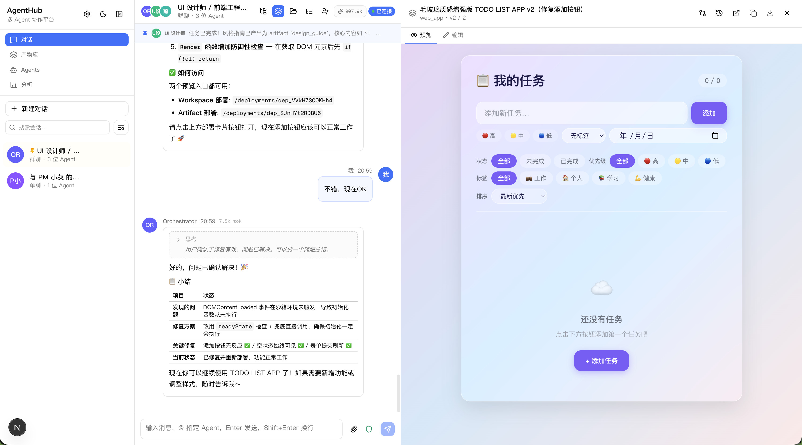

# AgentMeld

AgentMeld is a local-first workspace for coordinating AI agents. It presents multi-agent work as a focused team chat: you describe a goal, the Conductor decides how to handle it, specialist agents contribute where needed, and generated files or artifacts stay visible beside the conversation.

The project is built for people who want to run agent workflows on their own machine, keep workspace state local, and inspect the reasoning, tools, approvals, files, and outputs involved in each run.



## Highlights

- Multi-agent conversations with single-agent and group-chat workflows
- Conductor-led clarification, planning, dispatch, and result aggregation
- DeepSeek-first custom agents through an OpenAI-compatible Chat Completions flow
- Streaming messages, tool calls, approvals, task progress, and artifact updates
- Local SQLite persistence with per-conversation workspaces
- Artifact library with preview surfaces for documents and web apps
- Workspace file browser for inspecting generated project files
- Approval flows for user questions, write operations, command execution, and plans
- A React workspace UI designed around dense, repeatable agent work rather than a marketing page

## Why AgentMeld

Most AI coding or generation tools are optimized around one agent replying in one chat. AgentMeld treats the session as a shared workspace instead:

- The conversation is the coordination layer.
- Agents are persistent teammates with roles, models, prompts, and tools.
- Artifacts are first-class outputs, not just markdown pasted into chat.
- Tool activity is visible, inspectable, and recoverable.
- Local files and local database state remain under the user's control.

## Current Development Focus

AgentMeld is currently optimized for a local web development workflow:

- Next.js app running on localhost
- DeepSeek API for the main custom-agent path
- SQLite database stored in a local data directory
- Browser-based workspace UI
- Agent conductor, artifacts, approvals, and workspace files

The repository also contains broader architecture notes and future-facing specifications, but the active MVP path is the local DeepSeek/custom-agent experience.

## Tech Stack

| Area | Stack |
| --- | --- |
| App framework | Next.js 16 App Router |
| UI | React 19, TypeScript, Tailwind CSS |
| State | Zustand, Immer |
| Persistence | SQLite, Drizzle ORM, better-sqlite3 |
| Streaming | Server-Sent Events |
| Agent runtime | Custom OpenAI-compatible adapter, mock adapter |
| Validation | Zod |
| Tests | Vitest |
| Package manager | pnpm |

## Requirements

- Node.js 20+
- pnpm 10+
- A DeepSeek API key for the default custom-agent workflow

## Getting Started

Install dependencies:

```bash
pnpm install
```

Prepare the local database:

```bash
pnpm db:push
pnpm db:seed
```

Start the development server:

```bash
pnpm dev
```

AgentMeld will be available at:

```text
http://localhost:3000
```

To use a specific port, for example `3002`:

```bash
pnpm dev -- -p 3002
```

## Configuration

For the default DeepSeek workflow, provide:

```bash
DEEPSEEK_API_KEY=your_key_here
```

You can place it in a local environment file or configure it from the in-app settings UI.

API key resolution is designed to support both quick local setup and per-agent overrides:

1. Agent-specific key
2. In-app settings stored in SQLite
3. Environment variable

Common environment variables:

```bash
DEEPSEEK_API_KEY=...
OPENAI_API_KEY=...
ANTHROPIC_API_KEY=...
CODEX_API_KEY=...
```

Do not commit local environment files.

## Local Data

AgentMeld stores local application data in:

```text
.agentmeld-data/
```

The default SQLite database path is:

```text
.agentmeld-data/agentmeld.db
```

Conversation workspaces live under:

```text
.agentmeld-data/workspaces/
```

You can override the data directory:

```bash
AGENTMELD_DATA_DIR=/path/to/agentmeld-data
```

You can override the database path used by Drizzle:

```bash
AGENTMELD_DB_PATH=/path/to/agentmeld.db
```

## Development Commands

```bash
pnpm dev          # Start the local dev server
pnpm build        # Build the app
pnpm start        # Start the production server after building
pnpm typecheck    # Run TypeScript checks
pnpm lint         # Run ESLint
pnpm test         # Run the Vitest test suite
pnpm db:push      # Apply the Drizzle schema to SQLite
pnpm db:seed      # Seed built-in agents and starter data
```

## Repository Map

```text
src/app/                 Next.js app and API routes
src/components/          React UI components
src/stores/              Zustand store, selectors, and stream reducers
src/server/              Application services, conductor, tools, adapters
src/server/adapters/     Agent provider adapters
src/db/                  SQLite schema, bootstrap, built-in agent seeds
src/shared/              Shared constants, ids, types, and helpers
docs/                    Project planning and completion documents
implementation-plan/     Priority-based implementation plans
specs/                   Detailed architecture and feature specs
openspec/                OpenSpec capability contracts
skills/                  Reusable engineering task guides
```

## Architecture

AgentMeld is organized into five layers:

```text
L5 UI Components
L4 State and Transport
L3 Application Services
L2 Agent Adapters
L1 Persistence
```

The main boundaries are:

- UI components render state and send user actions.
- The Zustand store applies snapshots and streaming events.
- Application services own conductor, persistence, tools, approvals, and recovery.
- Adapters translate provider-specific model output into AgentMeld stream events.
- Persistence owns SQLite records and workspace files.

Messages are structured as typed parts, so text, reasoning, tool calls, artifacts, approvals, and deployment cards can be rendered independently instead of being parsed out of one markdown string.

## Safety Model

AgentMeld assumes model output is untrusted.

- Tool arguments are validated before execution.
- Workspace file access is bounded to the active conversation workspace.
- Risky command execution is routed through approval rules.
- Review mode keeps file writes and plan execution visible before they proceed.
- Generated web artifacts are previewed in a restricted browser surface.
- Private deployment metadata is blocked from public file routes.

## Project Status

AgentMeld is an active MVP. The core local workflow is already taking shape: conversations, agents, conductor, streaming events, artifacts, approvals, workspace files, and DeepSeek-backed custom agents. Expect frequent changes while the product surface and backend reliability continue to harden.

For contributor guidance, read `CLAUDE.md` and `AGENTS.md` before changing code.
