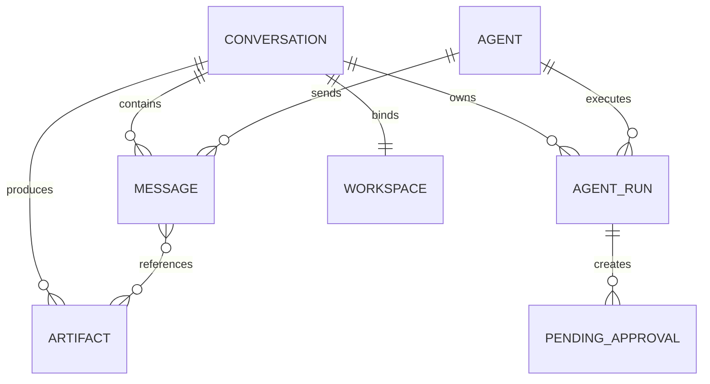
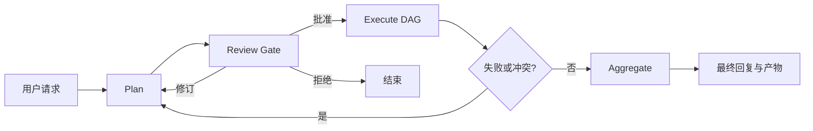

# AgentMeld 项目面试参考手册

> 用途：用于简历项目介绍、技术面试讲解、项目深挖、系统设计追问和复盘准备。  
> 项目地址：[https://github.com/jackie-cqz/AgentMeld](https://github.com/jackie-cqz/AgentMeld)  
> 当前公开版本：本地优先的 Web 应用，主路径为 DeepSeek / OpenAI-compatible Custom Agent。  
> 注意：Claude Code、Codex、Electron、移动端和外部 MCP 在架构中有设计或扩展位，但不能描述为当前完整可用能力。

---

## 1. 面试时先记住的项目定位

### 1.1 一句话介绍

AgentMeld 是一个本地优先的多 Agent 协作工作空间，它把多 Agent 任务执行做成团队群聊：用户提出目标，Conductor 判断是否需要澄清和拆分任务，再把任务分派给不同专业 Agent，并统一展示工具调用、文件变更、审批、执行进度和最终产物。

### 1.2 30 秒版本

> 我独立开发了 AgentMeld，一个基于 Next.js、TypeScript、SQLite 和 DeepSeek API 的本地多 Agent 协作平台。它不只是聊天界面，而是包含 Conductor 任务编排、DAG 并行调度、工具调用审批、上下文压缩、会话级文件工作区和产物部署预览的一整套 Agent Runtime。系统使用统一 StreamEvent 协议连接 Adapter、服务端、SSE、Zustand Store 和 React UI，并通过结构化 Message Parts 展示文本、思考、工具调用和产物。目前公开版本包含 465 项自动化测试。

### 1.3 1 分钟版本

> 这个项目主要解决单 Agent 在复杂任务中缺少角色分工、过程不可观察、工具副作用不安全和长会话上下文失控的问题。  
> 我把系统拆成五层：SQLite 和文件系统持久化层、模型 Adapter 层、AgentRunner 与工具执行服务层、Zustand 与 SSE 状态传输层、React 工作台 UI。  
> 用户发送消息后，服务端先持久化消息，再决定由单个 Agent、被 @ 的 Agent 或 Conductor 响应。Conductor 会经历 Plan、Review、Execute、Aggregate 四个阶段，通过 `plan_tasks` 生成结构化 DAG，用户审批后按依赖分波并行执行，失败时有工具自修复、子任务重试和重新规划三级恢复。  
> 工具调用不是直接执行：文件写入、命令和计划都有审批机制；所有路径都限制在会话 workspace 内。长会话则通过 Token 预算、Pinned Message、摘要和近期消息组合控制上下文。  
> 项目中我还重点解决了 DeepSeek 流式工具 JSON 重复拼接、动态提示词未真正发给模型、部署成功但产物库没有记录等真实工程问题。

### 1.4 3 分钟介绍版本

如果面试官让你完整介绍项目，可以直接按下面这个版本讲。整体控制在 3 分钟左右，重点是先讲问题，再讲架构和难点，最后主动说明边界。

> AgentMeld 是我独立开发的一个本地优先多 Agent 协作工作空间。它的目标不是再做一个普通聊天机器人，而是把复杂 AI 任务做成类似团队群聊的协作流程：用户提出一个目标，Conductor 先判断需求是否明确，如果不明确就通过 `ask_user` 追问；如果明确，就把任务拆成带依赖关系的计划，再分派给 PM、UI 设计师、前端工程师、Reviewer 等不同角色的 Agent，最后把过程、工具调用、审批和产物都沉淀在同一个会话工作区里。
>
> 我做这个项目的出发点是，单 Agent 在复杂任务里经常会遇到几个问题：第一，角色不清晰，同一个模型既写需求又写设计又写代码，质量不稳定；第二，过程不透明，用户不知道它读了什么文件、执行了什么命令、为什么做某个决定；第三，工具副作用比较危险，比如写文件和执行命令不能完全相信模型自己判断；第四，长会话上下文会越来越长，重要信息容易被稀释。所以 AgentMeld 的核心思路是，把模型能力包进一个可观察、可审批、可恢复的 Agent Runtime 里。
>
> 架构上我把系统拆成五层。最底层是 SQLite 和本地文件系统，负责保存 Agent、会话、消息、运行记录、审批、产物和 workspace 文件；第二层是模型 Adapter，目前公开版本主路径是 DeepSeek / OpenAI-compatible Custom Agent，同时保留了 Claude Code 和 Codex 的扩展边界；第三层是应用服务层，包括 AgentRunner、ConversationService、ConductorService、ToolRegistry、审批队列、上下文压缩和部署服务；第四层是 SSE 和 Zustand Store，负责把服务端 StreamEvent 应用到前端状态；第五层是 React 工作台 UI，包括聊天区、右侧产物库、工作区文件、工具调用卡片和设置面板。
>
> 一条消息的链路大概是这样的：用户在前端发送消息后，服务端先用 Zod 校验请求，然后把用户消息持久化到 SQLite，再根据会话类型决定由谁回复。单聊就是对应 Agent 回复，群聊里如果用户 @ 了某个 Agent，就由这个 Agent 回复；如果没有指定，就交给 Conductor。AgentRunner 会构建 system prompt、历史上下文、可用工具和 workspace 信息，然后调用 Adapter。Adapter 产生统一的 StreamEvent，服务端消费这些事件并持久化 Message Parts、Tool Call、Artifact 和 Run 状态，同时通过 SSE 推给前端，前端 Store 再更新 UI。
>
> 项目的一个重点是 Conductor 编排。Conductor 不是一个独立服务，而是一个特殊 Agent。它可以调用 `plan_tasks` 输出结构化 DAG，每个任务包含 agentId、标题、prompt、依赖、验收标准和预期产物。计划不会直接执行，而是先进入审批卡片，用户确认后系统按依赖分波执行。比如 PRD 任务完成后，UI 设计任务才能开始；设计完成后，前端实现和 Reviewer 才能继续。这样模型生成的自然语言计划就被转换成了代码可以校验和调度的任务图。
>
> 另一个重点是工具安全。Agent 可以调用 `fs_list`、`fs_read`、`fs_write`、`bash`、`write_artifact`、`deploy_workspace`、`ask_user` 等工具，但所有工具参数都被当成不可信输入处理：先解析 JSON，再经过 Zod 校验、工具权限校验、workspace 路径校验和命令黑名单检查。涉及文件写入、命令执行和任务计划的操作会进入审批流程。这样用户能看到模型想做什么，再决定是否允许。
>
> 产物这块我也做成了独立生命周期，而不是把内容塞进聊天文本里。比如 Agent 生成一个 Web App 后，可以通过 `write_artifact` 或 `deploy_workspace` 创建 Artifact，系统会保存产物元数据、版本、预览地址和部署快照。前端右侧产物库可以直接打开预览、查看源码或重新部署。这里我还修过一个真实问题：部署文件已经生成了，但产物库没有显示，根因是部署只是文件系统动作，没有创建 SQLite 里的 Artifact 业务实体，后来我补齐了 `artifact.create` 事件和持久化记录。
>
> 工程上比较有代表性的难点是 DeepSeek 流式工具调用。OpenAI-compatible 接口虽然长得像，但流式 `function.arguments` 不一定都是纯 delta，有时会返回累计快照或重复帧。如果简单字符串拼接，就会出现 JSON 重复、截断或者解析失败。我为工具参数实现了 merge 规则，兼容 delta、snapshot 和 duplicate 三种情况，并且在无法确定语义时明确失败，而不是静默修出一个可能错误的产物。
>
> 长上下文方面，我没有把所有历史都无脑发给模型，而是做了上下文工程：完整历史保存在 SQLite 里用于审计和恢复；真正发给模型时，会组合 pinned messages、近期消息、artifact 引用、任务摘要和上下文压缩结果，控制 token 预算。这样既保留了会话完整性，又避免模型上下文无限膨胀。
>
> 目前公开版本主要成熟的是 DeepSeek / OpenAI-compatible 主路径，包含多 Agent 会话、Conductor 编排、工具审批、文件工作区、Artifact 和本地部署预览；Claude Code、Codex SDK Adapter、Electron、移动端和外部 MCP 还属于扩展方向，不能说已经完整生产可用。质量方面，公开源码有 TypeScript strict、ESLint、Next build 和 Vitest 验证，目前包含 465 项自动化测试。整体来说，这个项目对我最大的价值是从“调用模型 API”走到了“设计 Agent Runtime”：真正复杂的地方不只是 Prompt，而是事件协议、状态管理、工具边界、调度、持久化、失败恢复和上下文工程。

这段话可以拆成下面 7 个节奏点，面试时根据对方反应删减：

1. **项目定位**：本地优先的多 Agent 协作工作空间，不是普通聊天机器人。
2. **问题来源**：单 Agent 缺少角色分工、过程透明度、副作用控制和上下文治理。
3. **系统架构**：SQLite/Workspace、Adapter、服务层、SSE/Zustand、React UI 五层。
4. **核心链路**：用户消息持久化后，经 AgentRunner、Adapter、StreamEvent、SSE 到前端。
5. **核心能力**：Conductor DAG 编排、审批机制、工具安全、Artifact 生命周期。
6. **工程难点**：DeepSeek 流式 Tool Args、部署与 Artifact 闭环、上下文压缩。
7. **当前边界**：DeepSeek 主路径可用，Claude/Codex SDK、Electron、移动端和 MCP 仍是 Roadmap。

---

## 2. 项目背景与问题定义

### 2.1 为什么做这个项目

传统 AI Chat 产品通常存在以下限制：

- 一次对话通常只有一个 Agent，需求、设计、开发和审查由同一角色完成。
- 复杂任务没有明确依赖关系，只能依靠模型在长文本中自行维持步骤。
- 工具执行过程不可见，用户难以知道模型读了什么文件、执行了什么命令。
- 文件修改和命令执行可能产生副作用，但普通聊天产品缺少审批闭环。
- 产物通常只是 Markdown 或代码块，缺少独立版本、预览、编辑和部署能力。
- 长会话持续把历史塞给模型，Token 成本增加且重要信息容易被稀释。
- 模型返回的结构化 Tool Call 并不总是可靠，尤其是 OpenAI-compatible 接口之间仍有语义差异。

AgentMeld 的核心思路是：

```text
聊天不是最终产品，而是协作入口
Agent 不是一次性回复者，而是带角色、模型、提示词和工具的长期协作者
Conductor 不是另一个页面，而是群聊里的项目经理
产物不是消息文本，而是有生命周期的独立实体
工具不是黑盒副作用，而是可观察、可审批、可恢复的执行过程
```

### 2.2 项目目标

- 提供接近 IM 群聊的多 Agent 协作体验。
- 将复杂任务转化为结构化、可审批、可执行的任务计划。
- 让模型输出、工具调用、审批状态和子任务进度可观察。
- 将文件和产物保存在用户本地。
- 对模型生成的路径、命令和结构化参数进行不信任校验。
- 为后续接入不同模型平台保留统一 Adapter 边界。

### 2.3 项目非目标

当前公开版本不重点解决：

- 云端多租户 SaaS。
- 企业级账号、RBAC 和团队权限。
- Claude Code / Codex SDK 的完整生产可用链路。
- 自动发布到 Vercel、AWS 等外部云平台。
- 跨设备长期记忆。
- Electron 和移动端正式发行。

明确非目标在面试中很重要，它体现你有范围控制意识，而不是“什么都做了一点”。

---

## 3. 技术栈与选型理由

| 模块 | 技术 | 选择理由 |
|---|---|---|
| 应用框架 | Next.js 16 App Router | 同时承载 React UI、REST API、SSE 和本地服务端逻辑 |
| 前端 | React 19、TypeScript strict | 组件化 UI、严格的事件与实体类型约束 |
| 样式 | Tailwind CSS | 快速建立工作台式密集 UI，并支持暗色模式 |
| 状态管理 | Zustand + Immer | 适合按 StreamEvent 做细粒度、可预测状态更新 |
| 持久化 | SQLite + Drizzle ORM + better-sqlite3 | 本地优先、零外部依赖、事务与查询能力足够 |
| 流式传输 | Server-Sent Events | 服务端到前端单向事件流，协议比 WebSocket 简单 |
| 模型接入 | DeepSeek / OpenAI-compatible | 当前主路径，兼容 Chat Completions 与 Tool Call |
| 校验 | Zod | API Body、LLM Tool Args 等不可信边界统一校验 |
| 测试 | Vitest | 覆盖服务、工具、Adapter、Store 和 API |
| 包管理 | pnpm | 锁文件稳定，依赖安装速度快 |

### 3.1 为什么选择 SQLite

适合回答：

> 项目定位是本地单用户工作空间，因此不需要先引入 PostgreSQL 和独立后端服务。SQLite 可以把 Agent、会话、消息、运行记录、审批、产物和设置集中保存在一个本地文件中，启动门槛低，也方便开源用户 clone 后直接运行。  
> 代价是并发写能力有限，所以我在 Conductor 子任务并发上增加了信号量控制，避免过多 Agent 同时写 SQLite 和调用模型 API。

### 3.2 为什么使用 SSE，而不是 WebSocket

适合回答：

> AgentMeld 的实时数据主要是服务端单向推送：文本增量、工具调用、运行状态、审批和产物事件。客户端动作仍然可以使用普通 REST API。因此 SSE 已经满足需求，并且具备浏览器原生支持、自动重连、协议简单和便于调试等优点。  
> 如果未来需要大量双向低延迟交互、多人协作编辑或终端输入流，再考虑 WebSocket。

### 3.3 FastAPI 在这个项目里的位置怎么回答

当前公开版本的后端运行在 Next.js App Router / Route Handlers 中，不是 FastAPI。面试时不要说“项目用了 FastAPI”。更准确的说法是：

> 当前版本为了降低开源运行成本，把 React UI、REST API、SSE 和本地服务端逻辑放在一个 Next.js 应用里。这样用户 clone 后只需要 `pnpm install` 和 `pnpm dev` 就能跑起来，SQLite 文件也在本地自动初始化。  
> 如果后续要把 Agent Runtime 拆成独立后端服务，我会优先考虑 FastAPI，因为它适合承载异步 Agent Run、长连接 SSE、Pydantic 参数校验、后台任务和 Python 生态里的模型/工具集成。前端仍然可以保持 Next.js，只把 `/api/*` 和 `/api/stream` 迁移到 FastAPI 服务。

可以这样解释为什么当前没有直接上 FastAPI：

- 当前项目是本地单用户工具，Next.js 单体应用更容易分发和启动。
- 主要复杂度在 Agent Runtime、工具审批、Artifact 和上下文治理，不在 HTTP 框架本身。
- 如果拆成 Next.js + FastAPI 双服务，会增加端口、CORS、鉴权、部署和本地开发复杂度。
- 当前 TypeScript 端到端类型、Zod 校验和 Zustand Store 对前后端协作更直接。
- FastAPI 更适合未来的独立 Agent 服务、Python 工具生态、远程 Worker 和云端多用户版本。

如果面试官继续追问“那用 FastAPI 怎么设计”，可以说：

```text
Next.js 前端
  -> REST: FastAPI /api/conversations, /api/messages, /api/approvals
  -> SSE:  FastAPI /api/stream
  -> FastAPI Service Layer: AgentRunner / ToolExecutor / Conductor
  -> DB: SQLite 或 PostgreSQL
  -> Workspace: 本地目录、容器目录或对象存储
```

在 FastAPI 中，SSE 可以用 `StreamingResponse` 或 `sse-starlette` 实现。服务端内部维护 EventBus，AgentRunner、ToolExecutor 和 Conductor 把事件写入队列；SSE endpoint 订阅队列，把事件序列化成标准 `text/event-stream` 格式推给浏览器。审批、发送消息、读取产物仍然用普通 REST API。

### 3.4 为什么使用结构化 Message Parts

如果把所有内容都拼成 Markdown，会产生以下问题：

- 前端必须用正则猜测哪些文本是工具调用。
- 工具参数、结果和错误难以稳定配对。
- Artifact 和部署卡片无法拥有独立交互。
- 思考过程、附件、文本无法分别控制展示策略。
- 历史上下文难以过滤内部信息。

因此消息使用：

```typescript
type MessagePart =
  | { type: "text"; content: string }
  | { type: "thinking"; content: string }
  | { type: "tool_use"; callId: string; toolName: string; args: unknown }
  | { type: "tool_result"; callId: string; result: unknown; isError?: boolean }
  | { type: "artifact_ref"; artifactId: string; title?: string }
  | { type: "deploy_status"; deployment: DeployStatusRecord }
  | { type: "image_attachment"; attachmentId: string; ... }
  | { type: "file_attachment"; attachmentId: string; ... };
```

---

## 4. 五层架构

```text
L5  UI Components
    ChatPanel / MessageParts / ToolCard / ArtifactPanel / Approval UI

L4  State + Transport
    Zustand Store / Selectors / Stream Reducers / SSE Client

L3  Application Services
    ConversationService / AgentRunner / ConductorService
    ToolRegistry / Approval Queues / Context Compaction / Deployment

L2  Agent Adapters
    CustomAgentAdapter / MockAdapter / ClaudeCodeAdapter / CodexAdapter

L1  Persistence
    SQLite / Drizzle / Workspace File System / Deployment Snapshots
```

### 4.1 分层原则

- UI 不直接调用模型 SDK。
- Adapter 不负责写业务数据库。
- 工具执行属于应用服务层，而不是 Adapter 内部业务逻辑。
- Adapter 只负责将不同 Provider 的输入输出翻译为统一 StreamEvent。
- Artifact 和 Message 是两个独立实体。
- 所有文件系统工具都必须经过 workspace 路径校验。

### 4.2 分层带来的好处

- 切换模型 Provider 不需要重写前端。
- UI 不需要理解 DeepSeek 的原始流式协议。
- 工具执行、审批和安全逻辑可以被多个 Adapter 复用。
- 服务层可以统一持久化 AgentRun、MessagePart 和 Artifact。
- 测试可以分别覆盖 Adapter、工具、服务和 Store。

---

## 5. 核心领域模型

### 5.1 七个核心实体

| 实体 | 职责 |
|---|---|
| Agent | 角色、模型、提示词、工具权限和 Adapter 配置 |
| Conversation | 单聊/群聊、参与 Agent、Workspace 策略和审批模式 |
| Message | 用户或 Agent 的一次结构化发言 |
| Artifact | 文档、Web App、图片、PPT 等独立产物 |
| Workspace | 会话对应的本地文件空间 |
| Tool | 模型可以调用的受控能力 |
| AgentRun | 一次 Agent 执行的可审计记录 |

扩展实体还包括 Attachment、PendingApproval、ContextSummary、DispatchPlan 等。

### 5.2 关键关系



### 5.3 为什么 Artifact 独立于 Message

Artifact 需要：

- 独立 ID。
- 类型和标题。
- 创建者和会话归属。
- 版本号与父版本。
- 独立预览和编辑。
- 被下游 Agent 通过 `read_artifact` 读取。
- 部署状态和下载能力。

Message 只通过 `artifact_ref` 引用 Artifact，避免把完整内容重复塞进消息和上下文。

---

## 6. 一条消息的完整链路

### 6.1 入口流程

```text
用户输入消息
  -> POST /api/conversations/:id/messages
  -> Zod 校验
  -> ConversationService.sendMessage()
  -> 写入 user Message
  -> 发布 message.added
  -> decideResponders()
  -> AgentRunner.run()
  -> Adapter.stream()
  -> consumeStream()
  -> Message Parts 持久化 + EventBus 发布
  -> /api/stream SSE
  -> Zustand applyEvent()
  -> React UI 更新
```

### 6.2 Responder 选择

```text
单聊
  -> 唯一 Agent 回复

群聊且包含 @mention
  -> 被 @ 的 Agent 回复

群聊且没有 @mention
  -> Conductor 回复
```

### 6.3 AgentRunner 的职责

- 创建 AgentRun 记录。
- 加载 Conversation、Agent 和 Workspace。
- 解析 API Key。
- 构建 System Prompt、历史消息和当前输入。
- 选择 Adapter。
- 消费 StreamEvent。
- 持久化 Message Parts。
- 处理 AbortSignal。
- 注入 Artifact 引用和部署状态。
- 更新 Run 状态、Token 用量和错误信息。

### 6.4 Next.js API 如何调用 LLM API

当前公开版本把前端页面、REST API、SSE 和本地 Agent Runtime 放在同一个 Next.js App Router 应用里。用户发送消息时，并不是前端直接调用 LLM，而是走一条受控的服务端链路：

```text
React Chat Input
  -> fetch("/api/conversations/:id/messages", { method: "POST" })
  -> Next.js Route Handler
  -> Zod 校验 request body
  -> ConversationService 持久化用户消息
  -> decideResponders 选择 Agent 或 Conductor
  -> AgentRunner 构造 AdapterInput
  -> CustomAgentAdapter 调用 DeepSeek/OpenAI-compatible API
  -> Adapter 产出 StreamEvent
  -> consumeStream 持久化 Message Parts / Tool Calls / Artifact
  -> EventBus 发布事件
  -> /api/stream SSE 推给前端
```

如果用伪代码表示，Next.js Route Handler 的职责大概是：

```typescript
export async function POST(request: Request, ctx: RouteContext) {
  const body = await request.json();
  const input = SendMessageSchema.parse(body);

  const result = await conversationService.sendMessage({
    conversationId: ctx.params.conversationId,
    content: input.content,
    attachments: input.attachments,
    mentions: input.mentions,
  });

  return Response.json(result);
}
```

这里 Route Handler 不直接拼 prompt，也不直接调用 DeepSeek。它只负责 HTTP 边界：解析请求、校验输入、调用服务层、返回一个可追踪的结果。真正的模型调用在 `AgentRunner -> Adapter` 这条链路里完成。

AgentRunner 接到任务后，会先准备一次 Agent Run 的执行上下文：

```text
AgentRunner.run()
  -> 读取 agent 配置：provider、model、systemPrompt、toolNames、apiKey
  -> 读取 conversation：参与者、workspace、审批模式、历史消息
  -> 读取 workspace：rootPath、可用文件上下文、产物引用
  -> 读取 app settings / env：API Key、baseURL、模型参数
  -> 构建 system prompt
  -> 构建 memory/context messages
  -> 构建 tools schema
  -> 调用 adapter.stream(input, signal)
```

AdapterInput 可以理解为一次模型调用的统一入参：

```typescript
type AdapterInput = {
  agent: AgentConfig;
  conversation: ConversationSnapshot;
  systemPrompt: string;
  messages: ChatMessage[];
  tools: ToolSchema[];
  workspace: WorkspaceContext;
  artifacts: ArtifactSummary[];
  signal: AbortSignal;
};
```

CustomAgentAdapter 再把这个统一入参翻译成 DeepSeek / OpenAI-compatible Chat Completions 请求：

```typescript
const response = await client.chat.completions.create({
  model: input.agent.model,
  messages: [
    { role: "system", content: input.systemPrompt },
    ...input.messages,
  ],
  tools: input.tools,
  stream: true,
}, { signal });
```

真实实现里还要处理 Tool Loop。也就是说，如果模型返回 `tool_calls`，Adapter 不会立刻结束，而是：

```text
模型返回 tool_calls
  -> 合并流式 tool arguments
  -> JSON parse + Zod 校验
  -> ToolRegistry 执行工具
  -> 工具结果写回 messages
  -> 再次调用 LLM
  -> 直到模型输出最终文本或达到轮次上限
```

这个设计的重点是分层清晰：

- Next.js API 负责 HTTP 边界和本地服务入口。
- ConversationService 负责会话事实和消息持久化。
- AgentRunner 负责一次 Agent 执行的生命周期。
- Context Builder 负责把历史、记忆、产物和当前输入整理成模型上下文。
- Adapter 负责把统一输入翻译成具体 Provider 的 API 调用。
- ToolRegistry 负责真正执行文件、命令、产物和用户确认等工具。
- SSE 负责把过程实时推给前端。

面试中可以强调：前端从来不直接拿 API Key 调 LLM，API Key 解析、Prompt 构建、工具权限和上下文裁剪都在服务端完成。这样可以避免泄露密钥，也能保证每次 LLM 调用都经过同一套安全和上下文治理逻辑。

### 6.5 记忆信息和上下文如何一起进入 LLM 请求

AgentMeld 不把“记忆”理解成一个无限追加的字符串，而是把上下文拆成不同来源，然后在 AgentRunner 调用 Adapter 之前重新组装。完整历史保存在 SQLite，模型请求只带当前任务需要的子集。

一次 LLM 请求里的上下文大致来自这些部分：

```text
System Prompt
  -> Agent 角色、能力边界、工具规则、输出约束

Runtime Context
  -> 当前会话 ID、workspace 信息、参与 Agent 列表、当前时间、审批模式

Durable Memory
  -> Pinned Messages、已确认用户偏好、关键任务结论、Context Summary

Recent Messages
  -> 最近几轮用户和 Agent 的公开文本

Artifacts Context
  -> 当前会话已有产物的标题、类型、版本、artifactId、摘要

Task Context
  -> Conductor 分派的子任务 prompt、依赖任务结果、验收标准、outputKey

Tool-Readable Context
  -> 不直接塞进 prompt 的大文件、大产物和命令输出，通过 fs_read/read_artifact 等工具按需读取
```

组装时可以理解成一个预算控制问题：

```text
固定优先级最高：
  system prompt / tool rules / agent identity

强相关事实：
  当前用户消息 / 当前任务 / 被 @ 的 Agent / Conductor plan

长期但精炼的信息：
  pinned messages / summaries / confirmed preferences

近期上下文：
  最近 N 条公开消息

按需引用：
  artifact metadata / file list / workspace summary

不直接进入：
  大段 tool result / 完整文件内容 / 旧的 thinking / 已过期结论 / 无关闲聊
```

如果把所有历史消息都塞进 LLM，会有几个问题：

- Token 成本随会话长度线性增长。
- 模型更容易被旧结论干扰。
- 工具输出和错误日志会污染回答。
- Provider 的 tool_call_id 跨 run 回放可能失效。
- 长文档、源码和部署日志会挤掉真正重要的用户目标。

因此实际策略是：

1. **完整保存**：所有消息、工具调用、产物和运行记录都保存在 SQLite，用于审计和恢复。
2. **选择性注入**：只有当前任务需要的记忆才进入 prompt。
3. **摘要压缩**：长会话通过 Context Summary 表达当前工作状态，而不是重复所有历史。
4. **引用优先**：产物和文件优先以 `artifactId`、路径、标题和摘要进入上下文，完整内容通过工具读取。
5. **过期覆盖**：旧结论如果被新消息、审批结果或新版本 Artifact 覆盖，就不再作为当前事实注入。
6. **角色视角**：不同 Agent 看到的上下文不同，PM 更关注需求和验收，UI 设计师更关注风格和交互，前端工程师更关注文件、代码和部署结果。

一个面试里可以直接讲的例子：

> 用户让系统做一个 Todo App。Conductor 先拿到用户原始需求、当前群聊 Agent 列表、可用工具和已有产物摘要。如果需求明确，它会生成任务计划。PM Agent 执行时，prompt 里会重点放用户需求、Conductor 分配的 PRD 任务和验收标准；UI 设计师执行时，会额外拿到 PM 产出的 PRD artifact 引用；前端工程师执行时，会拿到 PRD、设计稿摘要、workspace 文件列表和部署工具说明，但不会把所有聊天历史、所有中间工具日志都塞进去。这样每个 Agent 拿到的是和自己任务相关的工作记忆，而不是整段会话的原始转录。

如果面试官问“这是不是 Memory”，可以这样回答：

> 是，但它不是无边界长期记忆，而是受控的工作记忆。AgentMeld 里的 Memory 分成三层：数据库里的完整事实、摘要和 pinned 形成的长期工作状态、当前 prompt 里的短期任务上下文。真正发给模型的是第三层，并且由前两层按规则生成。这样既能让 Agent 记住关键决策，又不会把旧信息一直带着跑。

---

## 7. 统一 StreamEvent 协议

### 7.1 为什么需要统一协议

不同模型输出形式不同：

- DeepSeek 返回 Chat Completions 增量。
- SDK Adapter 可能返回自己的事件对象。
- 工具执行会产生调用和结果。
- 审批和 Conductor 调度不是模型 Token。

如果前端分别适配这些数据源，复杂度会快速失控。因此所有实时变化都翻译为 StreamEvent。

### 7.2 主要事件族

```text
Message:
  message.added
  message.updated

Part:
  part.start
  part.delta
  part.end

Tool:
  tool.call
  tool.result

Run:
  run.start
  run.usage
  run.end

Artifact:
  artifact.create
  artifact.update
  deploy.status

Approval:
  fs_write.pending / resolved
  bash_command.pending / resolved
  ask_user.pending / answered / cancelled

Dispatch:
  dispatch.plan
  dispatch.start
  dispatch.progress
  dispatch.end

Compaction:
  compaction.start
  compaction.progress
  compaction.end
  compaction.error
```

### 7.3 EventBus 与 globalThis 单例

Next.js 开发模式会热更新模块。如果每次 reload 都创建新的 EventBus：

- SSE 订阅可能挂在旧实例。
- 新事件发布到新实例。
- 前端看不到事件。

因此使用 `globalThis.__agentMeldEventBus` 保存单例。Pending Approval、任务证据等进程内状态也使用类似策略。

### 7.4 持久化与透传

不是所有事件都直接写数据库：

- Message、MessagePart、AgentRun、Artifact 等需要持久化。
- 文本增量可在内存中累积后更新 Message Parts。
- Pending 事件会保留审批记录，同时通过 SSE 实时通知。
- 纯 UI 进度事件可以只透传。

面试时可以强调：事件协议负责解耦，但仍要明确哪些事件是事实数据，哪些只是瞬时状态。

### 7.5 SSE 的工程实现细节

SSE 的核心是浏览器 `EventSource` 和服务端 `text/event-stream` 响应。AgentMeld 的实时链路可以概括为：

```text
AgentRunner / ToolExecutor / Conductor
  -> EventBus.publish(StreamEvent)
  -> /api/stream 订阅 EventBus
  -> 按 SSE 格式写入 response
  -> 浏览器 EventSource.onmessage
  -> Zustand applyEvent()
  -> React 局部刷新
```

标准 SSE 帧大致长这样：

```text
id: evt_001
event: message
data: {"type":"part.delta","messageId":"msg_1","delta":"hello"}

```

工程上要注意几件事：

1. **连接生命周期**：SSE 是长连接，服务端必须监听 `AbortSignal` 或 request close，用户切换页面、刷新或关闭浏览器时要及时取消订阅，避免 EventBus listener 泄漏。
2. **心跳保活**：如果一段时间没有业务事件，可以发送注释帧 `: ping\n\n`，避免代理层或浏览器认为连接空闲而断开。
3. **自动重连**：浏览器 `EventSource` 自带重连，但它只能保证重新建立连接，不保证中间所有事件都没丢。因此前端不能只依赖流式增量。
4. **事件 ID**：服务端可以给事件分配递增 ID 或时间序列 ID，客户端重连时通过 `Last-Event-ID` 告诉服务端上次收到的位置。当前项目更偏本地单用户，主要依赖短 replay 和 REST 快照兜底；如果云端化，需要把事件 offset 持久化。
5. **事实快照兜底**：SSE 适合传增量，但最终事实以数据库为准。页面刷新、SSE 断线或错过事件后，前端通过 Bootstrap API 重新读取 conversations、messages、artifacts、pending approvals 等事实状态。
6. **事件幂等**：前端 reducer 应该能处理重复事件，比如同一个 `message.updated` 或 `artifact.create` 重放时，不应该插入两份数据。Store 通常用 `id -> entity` 的 Map 结构，而不是只 push 数组。
7. **背压和截断**：LLM 文本增量可能很频繁，服务端不能为每个 token 做昂贵 DB 写入。更合理的是在内存中合并文本增量，按 part 或 message 粒度落库；前端也可以批量应用 delta，避免过度渲染。
8. **代理配置**：如果部署到 Nginx、Vercel-like 平台或公司网关，要注意关闭响应缓冲、延长 read timeout、设置 `Cache-Control: no-cache`、`Content-Type: text/event-stream` 和必要的 CORS。

面试回答可以总结为：

> 我把 SSE 当成实时增量通道，而不是唯一事实来源。真正可靠的状态仍然在数据库里，SSE 负责让 UI 快速感知变化，REST Snapshot 负责刷新和断线后的恢复。这种设计比单纯依赖长连接更稳，也比 WebSocket 更符合当前单向流式推送场景。

### 7.6 如果用 FastAPI 实现 SSE

如果把后端拆成 FastAPI，核心实现通常是：

```python
from fastapi import FastAPI, Request
from fastapi.responses import StreamingResponse
import asyncio
import json

app = FastAPI()

async def event_generator(request: Request):
    queue = subscribe_to_event_bus()
    try:
        while not await request.is_disconnected():
            try:
                event = await asyncio.wait_for(queue.get(), timeout=15)
                payload = json.dumps(event, ensure_ascii=False)
                yield f"event: message\ndata: {payload}\n\n"
            except asyncio.TimeoutError:
                yield ": ping\n\n"
    finally:
        unsubscribe_from_event_bus(queue)

@app.get("/api/stream")
async def stream(request: Request):
    return StreamingResponse(
        event_generator(request),
        media_type="text/event-stream",
        headers={
            "Cache-Control": "no-cache",
            "X-Accel-Buffering": "no",
        },
    )
```

这个代码只展示思路，真实项目里还需要：

- 根据用户、会话或 workspace 过滤事件。
- 支持 `Last-Event-ID` 和 replay。
- 对每个连接设置队列上限，避免慢客户端堆积内存。
- 在后台任务、Agent Run 和 Tool Executor 中统一发布 StreamEvent。
- 把可恢复事件写入数据库或 Redis Stream，避免服务重启后丢失。
- 对审批类事件提供 REST 查询兜底，刷新页面后仍能看到待处理审批。

FastAPI 的优势是 Python 异步生态更适合接模型工具、数据处理和远程 Worker；代价是本项目会从一个 Next.js 单体变成前后端双服务，需要处理 CORS、鉴权、部署、端口和跨服务类型契约。因此当前版本保持 Next.js 单体是为了本地优先和开源启动简单。

---

## 8. Adapter 设计与 Tool Loop

### 8.1 Adapter 接口

```typescript
interface AgentPlatformAdapter {
  readonly name: AdapterName;
  stream(input: AdapterInput, signal: AbortSignal): AsyncIterable<StreamEvent>;
}
```

上层只消费 `AsyncIterable<StreamEvent>`，不感知 Provider 细节。

### 8.2 当前 Adapter 状态

| Adapter | 状态 | 面试表述 |
|---|---|---|
| CustomAgentAdapter | 主路径可用 | 支持 DeepSeek / OpenAI-compatible Chat Completions |
| MockAdapter | 可用 | 用于开发和测试 |
| ClaudeCodeAdapter | 扩展骨架 | 完整 SDK 执行链仍在完善 |
| CodexAdapter | 扩展骨架 | 完整 SDK 执行链仍在完善 |

不要说 Claude/Codex 已完整接入。

### 8.3 Tool Loop

```text
调用模型
  -> 收到 text / reasoning / tool_calls
  -> 累积工具参数
  -> 校验并执行工具
  -> 生成 tool.result
  -> 把 assistant tool_calls 和 tool result 回灌给模型
  -> 模型根据结果继续
  -> 直到没有工具调用、达到轮次上限或被中止
```

核心代码形态：

```typescript
while (turn < MAX_TURNS) {
  const response = await client.chat.completions.create(...);
  yield textAndThinkingEvents(response);

  if (!hasToolCalls(response)) break;

  const results = await executeToolCalls(response);
  messages.push(assistantToolCallMessage(response));
  messages.push(...toolResultMessages(results));
}
```

### 8.4 为什么 Tool Loop 放在 Adapter

Custom Chat Completions 协议要求：

- 保存 Provider 需要的 assistant tool_calls 结构。
- 使用准确的 tool_call_id 回灌结果。
- 保留 DeepSeek reasoning 内容。
- 处理该 Provider 的流式参数语义。

工具本身仍由 ToolRegistry 执行，因此 Adapter 只控制协议循环，不拥有业务副作用。

---

## 9. 工具系统

### 9.1 ToolDef

```typescript
interface ToolDef {
  name: string;
  description: string;
  parameters: JsonSchema;
  execute(args: unknown, context: ToolContext): Promise<ToolResult>;
}
```

### 9.2 当前主要工具

| 分类 | 工具 | 作用 |
|---|---|---|
| 文件 | `fs_list` | 浏览 Workspace |
| 文件 | `fs_read` | 读取文本文件 |
| 文件 | `fs_write` | 创建或修改文件 |
| 命令 | `bash` | 在 Workspace 中执行命令 |
| 产物 | `write_artifact` | 创建独立 Artifact |
| 产物 | `read_artifact` | 读取当前会话产物 |
| 产物 | `deploy_artifact` | 部署 Web App Artifact |
| 产物 | `deploy_workspace` | 部署 Workspace 构建目录 |
| 附件 | `read_attachment` | 读取用户附件 |
| 用户交互 | `ask_user` | 发起结构化问题 |
| 编排 | `plan_tasks` | Conductor 输出任务计划 |
| 编排 | `report_task_result` | 子 Agent 汇报结构化结果 |

### 9.3 为什么使用 Registry

- 根据 Agent 的 `toolNames` 动态生成工具集合。
- 普通 Agent 不能获得 Conductor 专用工具。
- Builder 层和 Service 层都做权限检查。
- 新增工具只需要注册 ToolDef，不需要改 Adapter 主流程。

### 9.4 工具边界校验

所有 LLM Tool Args 都是不可信输入，需要：

1. JSON 解析。
2. Zod Schema 校验。
3. Agent 工具权限检查。
4. Workspace 路径校验。
5. 命令安全检查。
6. 审批策略检查。
7. 副作用执行。
8. 结构化结果返回。

### 9.5 当前工具系统和 MCP 的区别

AgentMeld 当前使用的是内置 Tool Registry，不是完整 MCP 架构。它的核心目标是把本项目需要的文件、命令、Artifact、审批和 Conductor 编排工具做成统一的本地受控能力。

可以这样区分：

| 维度 | 当前 Tool Registry | MCP |
|---|---|---|
| 定位 | AgentMeld 内部工具注册与执行层 | 外部工具、资源和 Prompt 的标准接入协议 |
| 调用关系 | Agent -> AgentMeld ToolRegistry -> 本地 handler | MCP Client -> MCP Server -> tools/resources/prompts |
| 工具来源 | 项目代码内置，和业务强耦合 | 可以来自外部进程、第三方服务或独立工具服务 |
| 权限模型 | 由 AgentMeld 的 Agent 配置、审批、Workspace 沙箱控制 | MCP 本身提供协议边界，应用仍需自行做权限、审批和审计 |
| 上下文能力 | 主要通过 Tool Result、Artifact、Workspace 文件回填 | 除 tools 外，还可以标准化暴露 resources 和 prompts |
| 部署方式 | Next.js 单体服务内执行 | 通常是独立 MCP Server，通过 stdio、HTTP 或其他 transport 接入 |

面试时可以这样回答：

> 当前项目没有直接使用 MCP，是因为我首先要把 Agent Runtime 的核心闭环做稳：工具 Schema、权限校验、审批、路径沙箱、Artifact 生命周期、SSE 事件和数据库证据。这些是 AgentMeld 的业务核心，不能简单交给外部协议。MCP 更适合作为后续工具生态接入层，而不是替代内部 Runtime。

### 9.6 为什么当前没有直接改成 MCP

当前阶段保留内置 Tool Registry 有几个实际原因：

1. **业务耦合更强**：`write_artifact`、`deploy_workspace`、`plan_tasks`、`ask_user` 不只是普通函数，它们会写数据库、发 SSE、进入审批、更新 Artifact 和 Run 状态。
2. **本地运行更简单**：开源用户只需要启动一个 Next.js 应用，不需要额外管理多个 MCP server 进程。
3. **安全边界更可控**：文件和命令工具直接绑定 conversation workspace，可以在同一服务层统一做路径校验、配额、审批和审计。
4. **前端状态更一致**：工具调用结果不是简单文本，而是会转成 Message Parts、Artifact 卡片、审批卡片和部署状态。
5. **调试成本更低**：早期开发阶段，内置工具可以直接写单元测试和集成测试，定位 JSON repair、权限校验和事件流更直接。

这不代表 MCP 不重要。更准确的定位是：当前 Tool Registry 是 AgentMeld 的内部工具执行核心；MCP 是未来扩展外部工具生态的协议层。

### 9.7 如果后续改成 MCP，应该怎么做

后续不建议把现有工具系统“一刀切替换成 MCP”，更合理的是做一层 MCP Adapter，把外部 MCP server 暴露的能力映射进现有 Tool Registry，让 AgentMeld 继续保留审批、事件、持久化和 Artifact 业务语义。

推荐迁移路径：

1. **定义 MCPClientService**
   - 管理 MCP server 配置、连接、重连和健康检查。
   - 支持 stdio / HTTP transport 的抽象。
   - 拉取 server 暴露的 tools、resources、prompts。

2. **把 MCP Tool 映射成 ToolDef**
   - MCP tool name 映射为 AgentMeld 内部 tool name，例如 `mcp.github.search_issues`。
   - MCP input schema 转换为 AgentMeld 的 JSON Schema / Zod 校验。
   - MCP tool description 进入模型工具描述，但要追加本地权限和风险说明。

3. **保留 AgentMeld 的权限与审批层**
   - Agent 配置中仍然通过 `toolNames` 控制能否使用某个 MCP tool。
   - 高风险 MCP tool 仍然进入审批，例如外部写文件、发请求、改 GitHub Issue、访问私有数据。
   - 审批 UI 展示 MCP server 名称、tool 名称、参数摘要、风险等级和目标资源。

4. **统一 Tool Result 和 StreamEvent**
   - MCP 返回结果不能直接透传给前端。
   - 需要转换为 AgentMeld 的 `tool_result`、`artifact_ref`、`deploy_status` 或普通 text part。
   - 如果 MCP tool 产出文件、网页或文档，仍然建议落成 AgentMeld Artifact，进入版本和预览生命周期。

5. **接入 MCP Resources**
   - MCP resource 可以作为上下文来源，但不能无脑全部注入 prompt。
   - 应该经过 context builder 做筛选、摘要、引用和 token budget 控制。
   - 对敏感 resource 做权限过滤，避免某个 Agent 看到不该看的外部资料。

6. **接入 MCP Prompts**
   - MCP prompt 可以作为 Agent 模板或工具说明来源。
   - 但最终 system prompt 仍要经过 AgentMeld 的角色、安全边界、可用工具和当前会话上下文组装。
   - 不允许外部 MCP prompt 覆盖本地安全指令。

7. **增加 MCP 审计和测试**
   - 持久化 MCP server、tool、arguments、result summary、耗时和错误。
   - 对连接失败、schema 不兼容、tool 超时、server 返回大对象、权限拒绝做测试。
   - 在 UI 中标明调用来自外部 MCP，和内置工具区分。

迁移后的结构可以这样理解：

```text
          Built-in Tools
        / fs_read / fs_write / write_artifact / plan_tasks
Agent -> ToolRegistry -> Permission / Approval / Sandbox / EventBus / DB
        \ MCP Adapter -> MCP Client -> MCP Server tools/resources/prompts
```

这样做的好处是，MCP 负责扩展外部工具生态，AgentMeld 继续负责 Agent Runtime 里最关键的安全、状态、审批、事件和产物生命周期。

### 9.8 哪些工具适合 MCP 化，哪些不适合

适合优先 MCP 化的工具：

- 外部知识库检索，例如文档库、网页搜索、代码搜索、GitHub Issue 搜索。
- 第三方 SaaS 查询，例如 Notion、Linear、Jira、Slack、GitHub。
- 低风险只读工具，例如查询 API 文档、读取公共资源、检索历史资料。
- 可独立部署的工具服务，例如 OCR、图片分析、格式转换、向量检索。

不建议第一阶段 MCP 化的核心工具：

- `plan_tasks`：它是 Conductor 编排协议的一部分，和任务 DAG、审批、Agent 白名单强绑定。
- `ask_user`：它依赖前端审批/问答 UI 和 pending resolver。
- `write_artifact` / `deploy_workspace`：它们绑定 Artifact 数据库、版本、部署路径、SSE 和右侧产物库。
- `fs_write` / `bash`：可以未来通过 MCP 扩展，但仍必须保留 AgentMeld 的 workspace 沙箱、命令策略和审批。

面试里可以总结成一句：

> MCP 适合扩展“外部工具从哪里来”，但 AgentMeld 的核心价值在于“工具被 Agent 调用后如何被校验、审批、持久化、展示和恢复”。所以未来会把 MCP 作为工具接入层，而不是把 Runtime 主体替换掉。

---

## 10. Workspace 沙箱与安全模型

### 10.1 基本原则

- 模型输出不可信。
- 路径必须 `resolve` 后仍在有效 Workspace 根目录内。
- 不能仅靠字符串 `startsWith`，需要处理分隔符、大小写和平台差异。
- 递归扫描不能盲目跟随 symlink / junction。
- 命令在执行前匹配平台黑名单。
- 高风险命令进入审批。
- 生成 Web 内容使用受限预览环境。

### 10.2 Workspace 模式

```text
sandbox:
  使用 AgentMeld 管理的数据目录
  强制配额和路径限制

local:
  绑定用户指定的真实项目目录
  仍校验敏感路径和命令安全
```

### 10.3 配额

典型限制：

- 单次 `fs_write` 内容大小限制。
- `fs_read` 单文件大小限制和文本截断。
- Sandbox Workspace 总容量和文件数限制。
- Bash timeout 上下限。
- 命令输出截断，防止无限占用内存。

### 10.4 跨平台命令

```text
POSIX:
  用户 shell + -c

Windows:
  powershell.exe -NoProfile -NonInteractive -Command
```

安全规则按 POSIX 和 Windows 分开维护，因为危险命令语法不同。

---

## 11. 审批机制

### 11.1 审批类型

- 文件写入审批。
- Bash 命令审批。
- Conductor Plan 审批。
- `ask_user` 用户选择。

### 11.2 Register → Await → Resolve

```text
工具调用
  -> 注册 Pending 记录
  -> EventBus 发布 pending 事件
  -> 工具 handler await Promise
  -> 前端显示审批卡片
  -> 用户调用 approve/reject API
  -> 服务端调用缓存的 resolver
  -> Promise 恢复
  -> 工具继续返回结果
```

### 11.3 为什么这个模式值得讲

它用一个很小的机制连接了两个相距很远的异步世界：

- 浏览器中的用户点击。
- Node.js 中正在等待的工具 Promise。

审批服务缓存 Promise 的 `resolve`，HTTP API 最终唤醒原工具调用，不需要轮询。

### 11.4 审批的可靠性问题

纯内存 Pending 状态会面临：

- 服务重启后丢失。
- 页面刷新后 UI 不知道当前 Pending。
- Run 中止后 Promise 可能悬挂。
- 重复 approve/reject。

对应措施：

- Pending Approval 持久化。
- 会话 Pending 查询 API 作为刷新恢复兜底。
- Abort 时统一 cancel。
- Resolve 操作幂等，只允许一次成功。
- SSE 实时事件与 REST Snapshot 结合。

---

## 12. Conductor 编排引擎

### 12.1 定位

Conductor 是特殊 Agent，不是另起一套模型服务。它仍通过 AgentRunner 和 Adapter 执行，只是：

- 有专用 System Prompt。
- 可以使用 `plan_tasks`。
- 负责计划、调度和聚合。
- 不直接充当所有专业角色。

### 12.2 四阶段流程



### 12.3 Plan 阶段

Conductor 根据：

- 用户当前目标。
- 当前群聊可用 Agent。
- 每个 Agent 的能力和工具。
- 已有 Artifact。
- 上一轮失败结果。

决定：

- 需求是否明确。
- 是否先调用 `ask_user`。
- 是否直接回复简单问题。
- 是否调用 `plan_tasks` 生成结构化计划。

### 12.4 为什么“需求是否明确”交给模型

项目没有使用关键词硬编码“需要澄清”，因为：

- 同一句话在不同上下文中清晰度不同。
- 用户可能授权系统自行决定细节。
- 是否澄清取决于未决选择是否显著影响任务、产物或验收。

代码负责限制允许的阶段和工具，语义判断交给 Conductor Prompt。

### 12.5 Plan Review Gate

计划生成后不会立即执行，而是：

- 持久化 Pending Plan。
- 前端显示任务、Agent、依赖和验收标准。
- 用户可以批准、拒绝或提交修订反馈。
- 修订反馈重新交给 Conductor 生成新计划。
- 服务端再次编译和校验最终计划。

### 12.6 Plan 校验

- Task ID 唯一。
- Agent ID 必须属于当前群聊。
- Conductor 不能把任务分给自己。
- `dependsOn` 引用必须存在。
- 不允许自依赖。
- 不允许循环依赖。
- Output Key 必须合理。
- Acceptance Criteria 必须完整。

### 12.7 动态 Agent ID 约束

模型容易生成 `frontend`、`designer` 等自然语言 ID，而真实 ID 是 `ag_xxx`。

系统采用三层防护：

1. Prompt 注入 `<allowed_agent_ids>`。
2. `plan_tasks` JSON Schema 动态生成 Agent ID enum。
3. Tool Handler 和 Plan Compiler 再次校验。

原则：能用结构化约束解决的，不只依靠提示词。

### 12.8 A2A 通信模型

A2A 可以理解为 Agent-to-Agent，但在 AgentMeld 里它不是“两个 Agent 随便互相私聊”，而是通过系统运行时约束后的协作通信。

当前主要有四种 A2A 通信方式：

```text
1. 会话消息
   Agent 在群聊里公开发言，其他 Agent 后续可以看到经过过滤后的公开文本。

2. 任务契约
   Conductor 通过 plan_tasks 把任务、依赖、验收标准、outputKey 分配给子 Agent。

3. Artifact 传递
   上游 Agent 生成 PRD、设计规范、Web App 等产物，下游 Agent 通过 artifactId 读取。

4. 结构化结果汇报
   子 Agent 通过 report_task_result 把状态、摘要、证据、产物 ID、失败原因交回 Conductor。
```

也就是说，Agent 之间不是靠自由文本“你去做一下”来协作，而是通过消息、任务、产物和结果报告这几种结构化载体协作。

### 12.9 为什么不让 Agent 直接互相调用

最直接的 A2A 方式是让一个 Agent 直接调用另一个 Agent，但 AgentMeld 当前没有这样做，而是让 Conductor 和调度器控制 Agent 间通信。

原因是：

- 直接互调容易递归失控。
- 很难做用户审批。
- 很难限制 Agent ID 和工具权限。
- 很难记录 DAG 依赖和执行证据。
- 很难知道某个任务失败后该重试哪个环节。
- 容易产生“模型以为分派了任务，但系统没有真实执行”的假状态。

因此 AgentMeld 的 A2A 是：

```text
Agent 不直接唤醒另一个 Agent
Conductor 生成任务计划
系统编译和校验计划
调度器按 DAG 启动对应 AgentRun
AgentRun 结果再回到 Conductor 聚合
```

这种做法牺牲了一点自由度，但换来可审批、可观测、可恢复。

### 12.10 A2A 任务契约

Conductor 生成的任务不是一段普通文本，而是结构化任务契约。一个子任务通常包含：

```text
id:
  任务 ID，例如 t1 / t2

agentId:
  必须是当前会话中真实存在的 Agent ID

title:
  给用户看的任务标题

prompt:
  交给子 Agent 的具体任务说明

dependsOn:
  上游依赖任务 ID

acceptanceCriteria:
  验收标准

outputKey:
  预期产物键，例如 prd / style-guide / web-app
```

这份任务契约解决三个问题：

- Conductor 的自然语言计划可以被代码校验。
- 下游 Agent 知道自己要交付什么，而不是泛泛“帮忙做一下”。
- Reviewer 和 Aggregate 阶段可以根据验收标准判断是否完成。

面试时可以说：

> 我把 A2A 的核心做成任务契约，而不是随意聊天。Agent 之间传递的是目标、依赖、产物和验收标准，这样才有办法做调度、审计和恢复。

### 12.11 A2A 产物传递

多 Agent 协作里，最重要的通信载体往往不是聊天文本，而是 Artifact。

例如一个 Todo App 流程：

```text
PM
  -> 产出 PRD artifact: art_prd_001

UI 设计师
  -> 读取 art_prd_001
  -> 产出风格指南 artifact: art_style_001

前端工程师
  -> 读取 art_prd_001 + art_style_001
  -> 修改 workspace 文件
  -> deploy_workspace 生成 art_web_001

Reviewer
  -> 读取 PRD、设计规范和 Web App 产物
  -> 输出审查报告

Conductor
  -> 聚合所有结果
  -> 给用户最终答复
```

这里的 A2A 不是“UI 设计师把全文复制给前端工程师”，而是：

```text
上游创建 Artifact
系统持久化 Artifact
下游通过 artifactId 引用和读取
```

这样做有几个好处：

- Artifact 有版本、类型和归属。
- 下游 Agent 可以按需读取完整内容。
- Prompt 里只需要放 artifact metadata，不必塞全文。
- 用户可以在产物库里看到同一份产物。
- 系统可以判断任务是否真的创建了预期产物。

### 12.12 A2A 上下文投影

不同 Agent 接收的上下文不是同一份聊天记录，而是由系统按任务投影出来的视图。

同一个会话事实，在不同 Agent 眼里会被组织成不同上下文：

```text
PM 看到:
  用户目标
  已确认约束
  需求澄清结果
  输出 PRD 的验收标准

UI 设计师看到:
  用户目标摘要
  PM 产出的 PRD artifact
  视觉偏好
  输出风格指南的验收标准

前端工程师看到:
  PRD artifact
  风格指南 artifact
  Workspace 文件列表
  构建和部署要求

Reviewer 看到:
  PRD
  风格指南
  Web App 产物
  验收标准和测试证据
```

这个过程可以理解为：

```text
Conversation facts
  -> 按 Agent 角色过滤
  -> 按任务依赖注入上游结果
  -> 按 token 预算保留 summary/pinned/recent/artifact metadata
  -> 形成单次 AgentRun 的 prompt
```

因此 A2A 的上下文管理重点不是“所有 Agent 共享同一段 memory”，而是：

> 所有 Agent 共享同一个会话事实源，但每个 Agent 拿到不同的任务视图。

### 12.13 A2A 结果回传

子 Agent 完成后，不应该只发一句“我完成了”。它需要把结构化结果回传给 Conductor：

```text
status:
  complete / failed / blocked

summary:
  做了什么

artifacts:
  outputKey -> artifactId

files:
  写入或修改的路径

commands:
  运行过的命令和结果

evidence:
  验收证据

error:
  失败原因
```

这些结果会进入：

- 任务状态。
- Conductor Aggregate。
- 下游任务上下文。
- 失败恢复上下文。
- 用户最终可见结果。

这就是为什么 `report_task_result` 很重要。它让 A2A 从“聊天接力”变成“带证据的任务交接”。

### 12.14 A2A 的边界和当前限制

当前 AgentMeld 的 A2A 更偏“受控任务协作”，不是完整的开放式 Agent 网络。

当前已经具备：

- Conductor 分派任务。
- 子 Agent 按 DAG 执行。
- Artifact 作为跨 Agent 交付物。
- `report_task_result` 汇报结构化结果。
- 上下文按角色和任务裁剪。
- 失败和依赖传播。

当前还可以继续加强：

- 更标准的 A2A message envelope。
- 更细的 task handoff schema。
- Agent-to-Agent direct mention 的权限模型。
- 子 Agent 之间的协商协议。
- 更完整的任务证据和冲突解决可视化。
- 跨会话或跨 workspace 的 A2A。

面试时可以稳一点说：

> AgentMeld 涉及 A2A，但不是开放式 Agent 网络。当前实现重点是受控的 Agent-to-Agent handoff：Conductor 通过任务契约分派，Agent 通过 Artifact 和 report_task_result 交接结果，系统负责上下文投影、权限、调度和恢复。

---

## 13. DAG 调度与并发

### 13.1 调度算法

```text
remaining = 所有任务

while remaining 非空:
  1. 把依赖失败的任务标记为 skipped
  2. 找到依赖全部 complete 的 ready tasks
  3. ready tasks 组成当前 wave
  4. Promise.all 并行执行当前 wave
  5. 保存结果并检测同波文件冲突
  6. 进入下一轮
```

### 13.2 为什么是“分波并行”

例如：

```text
t1: PM 输出 PRD
t2: UI 根据 PRD 输出设计规范
t3: 前端根据 PRD 和设计规范编码
t4: Reviewer 审查全部结果
```

依赖：

```text
t1 -> t2
t1,t2 -> t3
t1,t2,t3 -> t4
```

如果还有一个与 t2 无关的数据调研任务，可以与 t2 同波并行。

### 13.3 信号量

即使 DAG 允许很多任务并发，也不能无限并发：

- 模型 API 有速率限制。
- SQLite 同时写入会增加锁竞争。
- 本机 CPU 和磁盘资源有限。

因此使用 Semaphore 控制全局子 Agent 并发。

### 13.4 依赖失败传播

如果上游任务失败：

- 下游任务不会盲目运行。
- 标记为 `skipped`。
- 记录阻塞任务和原因。
- Aggregate 阶段向用户说明。
- Conductor 可以在下一轮重新规划。

---

## 14. 失败检测、证据与恢复

### 14.1 为什么“Agent 说完成”不等于完成

模型可能：

- 没有真正写文件。
- 命令失败但文字说成功。
- 没有产生要求的 Artifact。
- 产生了错误的 Artifact 类型。
- 忽略验收标准。
- 手写了虚假的部署路径。

因此任务结果必须结合执行证据。

### 14.2 任务证据

可以追踪：

- 写入或修改的文件。
- 执行的命令与 exitCode。
- 测试命令及结果。
- 创建的 Artifact 和 outputKey。
- `report_task_result` 的结构化验收结果。

### 14.3 三级恢复

#### Level 1：工具循环内自修复

工具返回错误后，LLM 在同一 Tool Loop 中读取错误并调整参数或命令。

#### Level 2：子任务重试

子 Agent 整轮执行失败后，调度器重新运行同一任务，并注入上次失败原因。

#### Level 3：Conductor 重新规划

一轮 DAG 出现失败、跳过或代码冲突后，Conductor 可以：

- 更换 Agent。
- 调整依赖。
- 把并行任务改为串行。
- 拆分任务。
- 新增补救任务。

### 14.4 文件冲突检测

同一 wave 中多个 Agent 可能修改相同文件。

系统记录：

```text
runId
taskId
agentId
absolutePath
contentHash
```

同一文件如果由不同任务写入不同内容，则生成冲突记录，交给 Conductor Aggregate 或 Replan。

---

## 15. 上下文工程

### 15.1 上下文工程解决什么问题

AgentMeld 里的上下文工程，核心不是“把历史消息拼接起来”，而是解决 Agent 长任务里的三个问题：

1. **模型窗口有限**：会话越长，消息、工具结果、产物、命令输出越多，不可能全部塞进 prompt。
2. **信息质量不均**：历史里既有用户真实约束，也有寒暄、失败日志、旧方案、Thinking 和大段 Tool Result。全部带进去会污染模型判断。
3. **多 Agent 视角不同**：PM、UI 设计师、前端工程师、Reviewer 需要看的上下文不一样。把同一份完整历史广播给所有 Agent，会增加成本，也会让角色边界变差。

因此 AgentMeld 把上下文拆成三个层次：

```text
完整事实层:
  SQLite messages / artifacts / agent_runs / approvals
  Workspace files / deployment snapshots / attachments

工作记忆层:
  Pinned Messages
  Conversation Summary
  Artifact metadata
  Conductor task results
  用户确认过的选择和约束

模型请求层:
  每次 AgentRunner 调用 Adapter 前临时组装的 prompt messages
```

面试时可以这样总结：

> 完整历史用于审计和恢复，工作记忆用于保留长期状态，模型请求上下文只放当前任务需要的信息。上下文工程的核心是“选择和压缩”，不是“全部记住”。

### 15.2 上下文来源

一次 Agent 执行前，AgentRunner 会从多个地方收集上下文：

| 来源 | 内容 | 是否完整进入 Prompt |
|---|---|---|
| Agent 配置 | 角色、system prompt、工具权限、模型配置 | 是，属于强约束 |
| Conversation | 会话模式、参与 Agent、pinned message IDs、审批策略 | 部分进入 |
| 当前用户输入 | 当前 turn 的目标、附件、@mention | 是，优先级最高 |
| Recent Messages | 最近若干轮公开消息 | 裁剪后进入 |
| Context Summary | 被压缩的历史工作状态 | 进入 |
| Pinned Messages | 用户明确固定的约束、决策、资源 | 原文进入 |
| Artifacts | 产物 ID、标题、类型、版本、摘要 | 元数据进入，完整内容按需读取 |
| Workspace | 根路径、模式、关键文件列表 | 摘要进入，文件内容按需读取 |
| Task Context | Conductor 分派任务、依赖结果、验收标准 | 子 Agent 执行时进入 |
| Tool Results | 文件读写、命令输出、部署结果 | 只保留必要公开结果，大段输出不直接进入 |

这个设计避免了一个常见问题：模型以为“历史消息里出现过的内容都是真实当前状态”。在 AgentMeld 中，当前事实优先来自数据库、Artifact、Workspace 和最新用户确认，而不是来自模型之前说过的话。

### 15.3 三层上下文架构的具体例子

只讲“完整事实层 / 工作记忆层 / 模型请求层”会有点抽象，下面用一个具体会话举例。

假设一个 Todo List 项目会话里依次发生了这些消息：

```text
m1  用户：我想做一个 Todo List 应用
m2  Conductor：你需要哪些功能？比如分类、截止日期、优先级？
m3  用户：要分类和优先级，不需要登录
m4  PM：我会产出 PRD
m5  PM：已创建 PRD Artifact：art_prd_001
m6  UI 设计师：我会做极简风格指南
m7  UI 设计师：已创建风格指南 Artifact：art_style_001
m8  前端工程师：开始实现 React 页面
m9  前端工程师：已写入 src/App.tsx 和 src/styles.css
m10 前端工程师：已部署预览：art_web_001
m11 Reviewer：发现缺少优先级筛选
m12 用户：优先级筛选必须补上
m13 前端工程师：已补充优先级筛选
m14 Reviewer：验收通过
m15 用户：接下来把视觉风格改成更活泼一点
```

#### 15.3.1 完整事实层长什么样

完整事实层是系统保存下来的所有真实记录，它不等于 prompt，而是数据库和文件系统里的完整事实：

```text
messages:
  m1 ~ m15 全部消息原文和 Message Parts

artifacts:
  art_prd_001
  art_style_001
  art_web_001

agent_runs:
  Conductor run
  PM run
  UI Designer run
  Frontend Engineer run
  Reviewer run

workspace files:
  src/App.tsx
  src/styles.css
  package.json
  dist/index.html
  ...

pending approvals / deployment snapshots / summaries:
  也都在事实层里有各自记录
```

这里 `m1` 会原封不动存在：

```text
m1 用户：我想做一个 Todo List 应用
```

即使后面已经压缩过 summary，`m1` 也不会被删除。完整事实层的职责是：

- 审计。
- 刷新恢复。
- 搜索。
- 重建上下文。
- 重新压缩。
- 查旧版本和执行链路。

#### 15.3.2 工作记忆层长什么样

工作记忆层是从完整事实中提炼出来、给后续任务长期复用的“当前项目状态”。它不追求保留所有原话，而追求保留对后续最重要的结论。

假设 `m1 ~ m7` 已经被压缩过，那么工作记忆层可能长这样：

```markdown
## 用户目标
- 用户要做一个 Todo List 应用。

## 已确认约束
- 需要分类功能。
- 需要优先级功能。
- 不需要登录。

## 已完成工作
- PM 已产出 PRD：art_prd_001。
- UI 设计师已产出极简风格指南：art_style_001。

## 重要资源
- PRD Artifact：art_prd_001。
- 风格指南 Artifact：art_style_001。

## 当前问题
- Reviewer 发现曾缺少优先级筛选。

## 下一步
- 根据最新用户需求调整视觉风格。
```

如果用户把 `m12` pin 了：

```text
m12 用户：优先级筛选必须补上
```

那么工作记忆层还会额外包含：

```text
Pinned:
优先级筛选必须补上
```

所以“工作记忆层”不只是 summary，而是：

```text
最新 summary
+ pinned messages
+ 关键 artifact 引用
+ 已确认用户偏好和任务状态
```

#### 15.3.3 单次模型上下文层长什么样

单次模型上下文层是某一次真正发给 LLM 的输入，它来自工作记忆层和最近消息，但只取这次任务需要的部分。

比如现在用户发了 `m15`：

```text
m15 用户：接下来把视觉风格改成更活泼一点
```

如果这次轮到 **UI 设计师** 执行，那么发给 UI 设计师模型的上下文可能是：

```text
System:
你是 UI 设计师，只负责视觉风格和交互，不写代码。

Durable Context:
- 用户要做 Todo List 应用
- 已确认需要分类和优先级
- 不需要登录
- 已有 PRD：art_prd_001
- 已有旧风格指南：art_style_001

Pinned:
- 优先级筛选必须补上

Recent Messages:
- m13 前端工程师：已补充优先级筛选
- m14 Reviewer：验收通过
- m15 用户：接下来把视觉风格改成更活泼一点

Artifacts:
- art_prd_001: Todo List PRD
- art_style_001: 极简风格指南
- art_web_001: 当前 Web App

Current Task:
请根据用户最新要求，更新视觉风格方向。
```

如果这次轮到 **前端工程师**，单次模型上下文又会不同：

```text
System:
你是前端工程师，负责修改 workspace 代码并部署。

Durable Context:
- Todo List 应用
- 分类 + 优先级
- 不需要登录
- 已有 PRD 和设计规范

Recent Messages:
- 用户想把视觉风格改成更活泼一点

Artifacts:
- art_prd_001
- art_style_002（如果 UI 已更新）

Workspace:
- src/App.tsx
- src/styles.css

Current Task:
根据新的风格指南修改页面，并重新 deploy_workspace。
```

这里最关键的是：  
同样的 `m1`，在三层里的表现不一样。

```text
完整事实层:
  m1 = “我想做一个 Todo List 应用”
  原文完整保留

工作记忆层:
  “用户目标：做一个 Todo List 应用”
  变成长期状态总结的一部分

单次模型上下文层:
  只在这次任务确实需要时，以 summary 或 task context 的形式进入 prompt
```

#### 15.3.4 这三层到底差在哪

可以用一句话区分：

```text
完整事实层:
  什么都不丢，负责真实记录

工作记忆层:
  保留当前还重要的长期状态

单次模型上下文层:
  为这一次调用模型临时打包需要的信息
```

再换一种更直观的说法：

```text
完整事实层 = 库房
工作记忆层 = 库房里整理好的长期货架
单次模型上下文层 = 这一次发货时打出来的包裹
```

面试时如果对方追问三层是不是很像，可以这样答：

> 它们的数据来源会重叠，但职责不同。完整事实层负责保存全部真实记录，工作记忆层负责把长期还重要的状态留下来，单次模型上下文层则是每次根据当前 Agent、当前任务、工具权限和 token 预算，从前两层里临时裁剪出来的请求输入。

### 15.4 Prompt 组装顺序

一次模型请求大致按以下顺序组装：

```text
1. System Prompt
   - Agent 角色
   - 能力边界
   - 工具使用规则
   - 安全约束
   - 输出格式要求

2. Runtime Context
   - 当前 conversationId / workspace 信息
   - 群聊参与 Agent 列表
   - 当前时间
   - 审批模式

3. Durable Context
   - 最新 Conversation Summary
   - Pinned Messages
   - 已确认用户偏好
   - 关键 Artifact 引用

4. Task Context
   - Conductor 分派的任务 prompt
   - dependencies / outputKey / acceptance criteria
   - 上游任务报告和产物引用

5. Recent Context
   - 摘要覆盖点之后的近期公开消息
   - 当前 Agent 可见的其他 Agent 公开发言

6. Current Turn
   - 当前用户消息
   - 当前附件引用
   - 当前 @mention

7. Output Reserve
   - 为模型回复、推理和 Tool Call 预留 token
```

重要原则：

- System Prompt 和工具规则优先级最高，不能被历史消息覆盖。
- 当前用户输入优先级高于历史摘要。
- Pinned Message 高于普通历史消息。
- Artifact 元数据高于模型自然语言里提到的产物 ID。
- Workspace 的真实文件状态高于模型之前声称的“我已经创建了文件”。

### 15.5 Token 预算

上下文组装本质上是预算分配：

```text
usableHistoryBudget =
  modelContextWindow
  - outputReserve
  - systemPromptTokens
  - toolSchemaTokens
  - currentTurnTokens
  - protocolMargin
```

再把可用历史预算分给：

```text
durableBudget:
  summary + pinned + confirmed constraints

artifactBudget:
  artifact metadata + short summaries

recentBudget:
  recent public messages

taskBudget:
  current task + dependency reports
```

为什么要预留 `outputReserve`：

- Tool Call 参数可能很长。
- 模型需要输出最终文本。
- 部分模型会输出 reasoning 或中间内容。
- 不预留会导致模型在关键位置被截断，尤其是 `write_artifact`、`plan_tasks` 这种结构化输出。

为什么要有 `protocolMargin`：

- 不同 provider 的 token 计算不完全一致。
- Chat Completions 还有 role、tool call、function result 等协议开销。
- 当前项目避免引入 provider-specific tokenizer，因此需要保守 margin。

面试时可以说：

> 我没有把 token 预算当成精确科学，而是用估算 + reserve + margin 的方式保证稳定性。生产级可以针对模型引入精确 tokenizer，但本地开源版本先保持实现简单。

### 15.6 历史过滤规则

跨 run 历史不会原样回放，主要过滤规则是：

保留：

- 用户文本。
- Agent 的公开最终文本。
- 必要的 Artifact 引用。
- 已完成任务的结构化结果。
- 用户明确确认的选择。
- 与当前任务相关的最近消息。

过滤或降权：

- Thinking。
- 旧 Tool Call / Tool Result 协议链。
- 大段命令输出。
- 失败重试中的中间噪声。
- 已被后续决定推翻的旧结论。
- 与当前 Agent 任务无关的其他 Agent 私有执行细节。

为什么不回放旧 Tool Call / Tool Result：

```text
旧 tool_call_id 属于上一轮 Provider 协议链
跨 run 回放容易出现 tool_call_id not found
大段工具结果会污染上下文
很多工具结果可以通过 fs_read / read_artifact 重新获取当前事实
```

因此历史消息会被渲染成更稳定的公共上下文，而不是重放原始 provider 消息流。

### 15.7 Pinned Messages

Pinned Message 是用户或系统明确标记的长期工作记忆。它适合保存：

- 技术栈约束，例如“只使用 Next.js 和 SQLite”。
- 产品目标，例如“做一个番茄钟 Web App”。
- 已确认选择，例如“使用 25+5 经典模式”。
- 重要资源，例如 PRD、设计规范、关键 Artifact。
- 禁止项，例如“不考虑桌面端和移动端”。

Pinned 的设计原则：

- Pinned 不参与普通摘要源，避免被摘要模型改写。
- 后续构造上下文时尽量以原文注入。
- 如果 pinned 内容过期，应由用户或系统明确取消/覆盖。
- Pinned 是“显式记忆”，比自动摘要更可靠。

面试可以这样讲：

> Pinned Message 是我给用户留的显式记忆控制入口。自动摘要可能损失信息，但 pinned 是用户认为重要的原文约束，所以优先级更高。

### 15.8 Conversation Summary

Conversation Summary 是长会话压缩后的工作状态快照，不是聊天记录摘要。

它应该回答这些问题：

```markdown
## 用户目标
当前用户到底要完成什么

## 已确认约束
技术栈、范围边界、用户选择、禁止项

## 已完成工作
已经生成了哪些文件、产物、任务结果

## 重要资源
Artifact ID、workspace 路径、关键文件、部署预览

## 当前问题
失败、阻塞、待确认事项

## 下一步
后续 Agent 应该继续做什么
```

不能包含：

- 寒暄。
- 完整 Thinking。
- 大段 Tool Result。
- 未经验证的模型自称完成。
- 被后续消息推翻的旧结论。
- 模型自行编造的 Artifact ID、部署 URL、文件路径。

这和普通“聊天摘要”不同：普通摘要是给人看的，Context Summary 是给后续 Agent 接着工作的，所以它更像任务状态快照。

### 15.9 Context Compaction 流程

压缩流程可以拆成八步：

```text
1. 查询当前 conversation 最新 summary
2. 找到 summary 覆盖边界之后的消息
3. 排除 pinned、system、未完成消息和不适合摘要的 part
4. 保留最近若干条消息不压缩
5. 将更旧的消息渲染成摘要输入
6. 调用可用模型生成结构化工作状态摘要
7. 写入 conversation_context_summaries
8. 后续 prompt 使用 Summary + Pinned + Recent
```

为什么要保存覆盖边界：

- 知道摘要覆盖到哪条消息。
- 避免同一批消息重复压缩。
- 新消息只需要在旧摘要基础上继续追加。
- 出错时不会删除原始消息。

数据库里保存：

```text
summary
covered_until_message_id
covered_until_created_at
source_message_count
token_estimate
model_provider / model_id
created_at
```

这保证 summary 是可追踪的，而不是一段来源不明的文本。

### 15.10 截断、摘要和检索的区别

```text
截断:
  直接丢弃最旧上下文
  成本最低
  容易丢失长期约束

摘要:
  把旧上下文压缩成状态快照
  成本中等
  适合保留目标、约束、进度

检索:
  按问题从历史、文件或产物中取相关片段
  成本取决于索引和召回
  适合大规模知识或代码库
```

AgentMeld 当前主要使用：

- Summary 保留长期工作状态。
- Pinned 保留显式关键约束。
- Recent 保留短期连续性。
- Tool 按需读取 Artifact 和 Workspace。
- FTS 支持消息搜索。

未来可以增强：

- Artifact 向量检索。
- Workspace 代码索引。
- Summary 质量评估。
- 过期结论标记。
- 每个 Agent 独立 memory profile。

### 15.11 多 Agent 场景下的上下文隔离

多 Agent 不是所有人共享同一份完整上下文。不同角色需要不同视图：

```text
Conductor:
  用户目标
  Agent 列表
  可用工具
  当前计划
  任务结果和阻塞

PM:
  用户需求
  已确认范围
  验收标准
  竞品/产品约束

UI 设计师:
  PRD 产物
  视觉偏好
  设计约束
  目标用户和页面结构

前端工程师:
  PRD
  设计规范
  Workspace 文件列表
  构建/部署要求
  上游 Artifact 引用

Reviewer:
  PRD
  设计规范
  实现产物
  测试和验收标准
```

这样做有几个好处：

- 降低 token 成本。
- 减少角色跑偏。
- 避免 Agent 看到不必要的工具细节。
- 让每个 Agent 专注自己的验收标准。

面试时可以说：

> 多 Agent 系统里，上下文工程不只是压缩，而是按角色做上下文投影。每个 Agent 看到的是同一个会话事实的不同视图。

### 15.12 A2A 场景下的上下文传递例子

A2A 上下文管理的关键是：上游 Agent 的输出不会原封不动塞给所有下游 Agent，而是根据任务依赖和角色需要重新投影。

以 Todo App 为例：

```text
t1 PM:
  输出 PRD art_prd_001

t2 UI 设计师:
  依赖 t1
  输入：用户目标摘要 + art_prd_001 metadata + t1 验收结果
  输出：风格指南 art_style_001

t3 前端工程师:
  依赖 t1, t2
  输入：用户目标摘要 + art_prd_001 + art_style_001 + workspace 文件列表
  输出：源码修改 + 部署产物 art_web_001

t4 Reviewer:
  依赖 t1, t2, t3
  输入：PRD + 风格指南 + Web App + 验收标准 + 部署预览
  输出：审查报告
```

这里每一步的上下文都来自同一个会话事实源，但进入 prompt 的内容不同：

```text
UI 设计师不需要完整命令输出
前端工程师不需要 PM 的所有推理过程
Reviewer 不需要前端每一次失败重试日志
Conductor 需要的是任务状态、产物 ID 和阻塞原因
```

上游结果传递时优先使用结构化载体：

```text
artifactId:
  下游可用 read_artifact 读取完整内容

outputKey:
  Conductor 知道某个任务交付了哪个逻辑产物

task report:
  下游知道上游完成情况、失败原因、验收结果

workspace path:
  前端工程师和 Reviewer 可以读取真实文件状态
```

这就是 AgentMeld 里的 A2A 上下文策略：

> Agent 共享事实源，但不共享完整 prompt。每次 AgentRun 都根据任务契约、依赖产物、角色能力和 token 预算生成自己的上下文视图。

### 15.13 Artifact 和 Workspace 如何参与上下文

Artifact 不直接全部塞进 prompt，而是先以元数据进入：

```text
artifactId
title
type
version
createdByAgent
short summary
deploymentPreviewPath
```

如果 Agent 需要完整内容，使用：

```text
read_artifact(artifactId)
fs_read(path)
fs_list(path)
```

这样做的理由：

- 文档和源码可能很长。
- Web App 可能包含多个文件。
- 部署产物可能包含二进制资源。
- 当前文件内容比历史消息里的文件描述更可信。

原则是：prompt 放索引和摘要，工具读取完整事实。

### 15.14 过期信息如何处理

上下文里最危险的不是缺信息，而是旧信息继续影响模型。典型例子：

- 用户一开始选择 Vue，后来改成 React。
- Conductor 初版计划有 5 个任务，后来重新规划成 3 个任务。
- 前端工程师曾经部署失败，后来已经成功。
- 旧 Artifact 被新版本替代。

处理策略：

1. **新消息覆盖旧消息**：用户最新明确选择优先。
2. **Artifact 版本覆盖旧版本**：默认引用最新版本。
3. **任务状态覆盖自然语言**：数据库里的 run/task 状态优先于模型文本。
4. **部署事件覆盖手写路径**：真实 `deploy.status` 优先于消息里的 URL。
5. **Summary 只记录当前状态**：过期结论不进入新摘要。
6. **Pinned 需要显式取消或更新**：因为 pinned 是强记忆，过期后必须明确处理。

面试时可以说：

> 我把上下文看成状态管理问题，而不是文本拼接问题。旧结论必须有覆盖机制，否则 Agent 会被历史污染。

### 15.15 失败和恢复中的上下文

当任务失败后，失败信息不会简单变成一段普通聊天历史，而是作为下一次执行的结构化上下文：

```text
failed run:
  error
  failed tool name
  invalid args
  exitCode
  stderr/stdout excerpt
  touched files
  generated artifacts
```

重试时注入：

- 上次失败原因。
- 哪些文件已经写过。
- 哪些 Artifact 已经创建。
- 哪些验收标准未满足。
- 用户是否已经拒绝过某个审批。

这样 Agent 不需要从一长串聊天里猜失败原因，而是得到明确的 recovery context。

### 15.16 面试总结话术

可以直接这样讲：

> AgentMeld 的上下文工程分成完整事实、工作记忆和模型请求三层。完整事实保存在 SQLite 和 workspace 文件系统里，工作记忆由 pinned、summary、artifact metadata 和任务结果组成，真正发给模型的是每次 run 前按角色、任务和 token 预算临时组装的上下文。  
> 我不会把所有历史消息全塞进去，因为旧工具结果、Thinking、大段日志和过期结论会污染模型。系统会保留当前任务、用户最新输入、pinned 约束、summary、recent messages 和相关 artifact 引用，大文件和完整产物通过工具按需读取。  
> 这套设计让长任务既能连续，又不会让上下文无限膨胀；多 Agent 也能看到各自需要的信息，而不是所有人共享同一份混乱聊天记录。

---

## 16. 前端架构与工作台设计

### 16.1 为什么不是普通聊天 UI

AgentMeld 的用户需要同时观察：

- 当前会话和参与 Agent。
- 实时消息。
- Thinking。
- Tool Call 和 Tool Result。
- Pending Approval。
- Dispatch Plan 和任务进度。
- Workspace 文件。
- Artifact 预览和版本。
- Token 和上下文状态。

因此界面更接近 IDE / 工作台，而不是营销页面或普通 IM。

### 16.2 Zustand Store

核心实体采用 Normalize 结构：

```typescript
messages: Record<MessageId, Message>;
messageIdsByConversation: Record<ConversationId, MessageId[]>;

runs: Record<RunId, AgentRun>;
runIdsByConversation: Record<ConversationId, RunId[]>;

artifacts: Record<ArtifactId, Artifact>;
artifactIdsByConversation: Record<ConversationId, ArtifactId[]>;
```

好处：

- SSE 更新单个实体时不需要遍历大数组。
- 组件通过 Selector 获取派生数据。
- 避免 Bootstrap、SSE 和组件各保存一份重复数组。
- 更容易保证事件幂等。

### 16.3 Reducer 按事件族拆分

```text
message-events
tool-events
run-events
artifact-events
pending-events
dispatch-events
compaction-events
```

Store 的 `applyEvent` 只负责路由到对应 Reducer。

### 16.4 主要 UI 组件

- Sidebar：会话列表、导航和设置。
- ChatPanel：会话 Header、消息区和输入区。
- MessageParts：根据 Part 类型分发渲染。
- ToolCard：工具调用状态、参数和结果。
- PendingQuestionCard：结构化用户问题。
- PendingApprovalPanel：命令和文件审批。
- DispatchProgress：Conductor 计划和执行进度。
- ConversationTabBar：对话、文件和 Diff Tab。
- WorkspaceFileBrowser：浏览会话 Workspace。
- ArtifactPanel：产物预览、编辑、版本和部署。
- CreateAgentDialog：快速创建和详细配置 Agent。

### 16.5 防止 Zustand getSnapshot 无限循环

React 19 下，Selector 如果每次调用都创建新数组：

```typescript
useAppStore((state) => state.itemsById[id] ?? [])
```

当 fallback `[]` 每次都是新引用时，可能触发：

```text
The result of getSnapshot should be cached
Maximum update depth exceeded
```

解决方式：

- 使用模块级稳定空数组常量。
- Selector 返回 Store 中的稳定引用。
- 避免在 Selector 内 `map/filter` 生成新数组。
- 派生计算使用稳定 Selector 或组件内 memo。

这个案例适合说明你理解 React External Store 的引用稳定性要求。

---

## 17. Artifact 与部署

### 17.1 Artifact 类型

- Document。
- Web App。
- Image。
- PPT。

共享类型中还保留 `code_file`、`diff` 等历史或扩展类型，但当前 `write_artifact` 对 Agent 开放的创建类型是以上四种。

### 17.2 版本模型

Artifact 使用：

```text
id
version
parentArtifactId
```

保存新版本时创建新行，不覆盖旧内容，可以做版本历史和比较。

### 17.3 Deployment 与 Artifact 的区别

```text
Deployment:
  文件系统中的静态快照和预览 URL

Artifact:
  SQLite 中的业务实体
  负责产物库、版本、会话归属和编辑
```

部署成功不等于 Artifact 已创建。这是项目中真实出现过的 Bug。

### 17.4 deploy_workspace 完整链路

```text
Agent 调 deploy_workspace
  -> 校验 Workspace 路径
  -> 复制静态构建目录
  -> 创建 Deployment Snapshot
  -> 创建 Web App Artifact
  -> 返回真实 artifactId
  -> Adapter 发布 deploy.status
  -> Adapter 发布 artifact.create
  -> Store 更新
  -> 聊天显示部署卡片
  -> 产物库实时出现 Web App
```

### 17.5 为什么不把所有构建文件塞进 SQLite

构建目录可能包含：

- 图片。
- 字体。
- 压缩 JS。
- Source Map。
- 二进制资源。

全部序列化到 JSON 会造成数据库膨胀和类型问题，因此 Deployment Snapshot 保存在文件系统，Artifact 保存业务元数据和预览关联。

### 17.6 各类持久化如何实现

AgentMeld 的持久化不是“所有东西都塞进 SQLite”，而是按数据性质分层：

```text
SQLite:
  业务事实、可查询实体、状态机状态、设置、摘要、索引

文件系统:
  Workspace 源码文件、附件原始文件、部署快照、构建产物

内存:
  正在进行的 SSE 订阅、等待用户点击的 Promise resolver、短期事件 replay

模型上下文:
  从 SQLite + 文件系统中按预算临时组装，不作为唯一事实来源
```

这种分层的原因是：SQLite 适合存结构化业务事实，文件系统适合存真实项目文件和静态资源，内存适合存当前进程内的实时连接和等待状态；模型 prompt 则只是一次请求的临时视图，不能当成数据库。

#### 17.6.1 数据目录与数据库初始化

本地数据默认放在 `.agentmeld-data/` 下。首次启动时，系统会自动初始化 SQLite 数据库和基础目录：

```text
.agentmeld-data/
  agentmeld.db
  workspaces/
    conv_xxx/
  deployments/
    dep_ws_xxx/
  attachments/
```

数据库层使用 SQLite + Drizzle schema + bootstrap SQL。Drizzle schema 负责类型化表结构，bootstrap 负责首次创建表、补历史字段、创建索引、创建 FTS 表、种子内置 Agent 和默认会话。初始化逻辑是幂等的：重复启动不会重复插入同一批内置数据，也不会破坏用户已有会话。

面试可以这样说：

> 我把首次运行体验做成本地自动初始化：用户 clone 项目后不需要手动建库，启动时会创建 SQLite 文件、基础表、默认 Agent 和每个会话对应的 workspace 目录。这样开源项目的运行门槛比较低。

#### 17.6.2 Agent 与配置持久化

`agents` 表保存 Agent 的长期配置：

```text
id / name / avatar / description
capabilities
system_prompt
adapter_name
model_provider / model_id / api_base_url
api_key
tool_names
is_builtin / is_conductor / supports_vision
created_at / updated_at
```

这里持久化的是“Agent 作为协作者的配置”，不是某一次回复。这样用户修改 Agent 的系统提示词、工具权限、模型配置后，新会话和后续 run 都能使用最新配置。

需要注意两点：

- 内置 Agent 通过 seed/bootstrap 创建，用户可在 UI 里编辑副本或自建 Agent。
- API Key 可以放在 Agent 级别，也可以放在全局 app settings 或环境变量中；返回前端时要做掩码，不能明文暴露。

#### 17.6.3 Conversation 与 Workspace 持久化

`conversations` 表保存会话级事实：

```text
id / title / mode
agent_ids
pinned_message_ids
archived
fs_write_approval_mode
created_at / updated_at
```

`workspaces` 表保存会话和本地目录的绑定关系：

```text
id
conversation_id
mode: sandbox | local
root_path
bound_path
created_at / updated_at
```

这里有一个重要设计：Conversation 是业务会话，Workspace 是它的文件空间。会话删除或归档不等于所有磁盘文件都立即消失；系统需要明确地区分业务状态和文件系统状态。

Workspace 有两种模式：

- `sandbox`：AgentMeld 管理的目录，通常在 `.agentmeld-data/workspaces/<conversationId>` 下，适合新建项目、生成 demo、跑命令。
- `local`：绑定用户已有项目目录，用于在真实项目上协作。仍然要做路径安全检查，防止 Agent 越界读写。

工具执行时不会直接相信模型传来的路径，而是把路径 resolve 到 workspace 根目录下，再检查是否仍在允许范围内。这样文件系统持久化和安全边界是一起设计的。

#### 17.6.4 Message 与 Message Parts 持久化

`messages` 表保存用户和 Agent 的结构化发言：

```text
id
conversation_id
role
agent_id
run_id
parts: MessagePart[]
status
mentioned_agent_ids
parent_message_id
created_at / updated_at
```

最关键的是 `parts` 字段，它是 JSON 数组，而不是一个纯文本字符串。一次 Agent 回复可能包含：

```text
text
thinking
tool_use
tool_result
artifact_ref
deploy_status
image_attachment
file_attachment
```

为什么这样存：

- 前端能稳定渲染工具卡片、产物卡片和普通文本，不需要正则猜。
- Tool Call 和 Tool Result 可以通过 callId 对齐。
- Artifact 可以只存引用，不把完整内容复制进消息。
- Thinking、Tool Result 这些内部信息可以在构造上下文时过滤掉。

流式回复时，服务端会先创建一条 assistant message，再随着 Adapter 的 `part.delta` 更新 message parts。文本增量可以在内存里合并，不需要每个 token 都写数据库；但关键状态，比如 message 完成、工具结果、产物引用，最终都要落库。

#### 17.6.5 AgentRun 持久化

`agent_runs` 表记录一次 Agent 执行：

```text
id
conversation_id
agent_id
trigger_message_id
parent_run_id
status
error
usage
started_at / finished_at
created_at / updated_at
```

它解决的是“这条回复是怎么来的”。Message 是对用户可见的内容，AgentRun 是执行审计记录。通过 run 可以追踪：

- 哪个 Agent 因为什么消息被触发。
- 是否是 Conductor 派生的子任务。
- run 当前是 running、complete、failed 还是 aborted。
- 错误信息是什么。
- Token 用量是多少。

多 Agent 编排时，`parent_run_id` 可以把 Conductor run 和子 Agent run 串起来。面试时可以强调：没有 AgentRun，系统只能看到消息结果，看不到执行过程；有了 AgentRun，才能做失败恢复、任务追踪和成本统计。

#### 17.6.6 Pending Approval 持久化

审批有两层状态：

```text
内存:
  pendingId -> Promise resolver

SQLite:
  pending_approvals 表保存审批事实
```

`pending_approvals` 保存：

```text
id
conversation_id
agent_id
run_id
approval_type
status: pending | approved | rejected | cancelled | interrupted
payload_json
created_at / updated_at
resolved_at
```

内存里的 resolver 用来唤醒正在等待的工具调用；SQLite 里的 pending record 用来支持刷新恢复、审计和幂等。

完整流程是：

```text
工具需要审批
  -> 写入 pending_approvals(status=pending)
  -> 内存注册 Promise resolver
  -> EventBus 发布 pending 事件
  -> 前端显示审批卡片
  -> 用户点击 approve/reject
  -> REST API 更新 pending_approvals
  -> 调用 resolver 唤醒工具
  -> EventBus 发布 resolved 事件
```

为什么不能只放内存：

- 页面刷新后 UI 需要重新看到 pending 审批。
- 服务端重启后 pending 不能假装还在执行。
- 用户重复点击 approve/reject 时需要幂等。
- Run 被 abort 时需要把相关 pending 标记为 cancelled。

因此启动恢复时可以把残留 `pending` 标记为 `interrupted`，避免旧 Promise 已经不存在但 UI 还以为可以审批。

#### 17.6.7 Artifact 持久化

`artifacts` 表保存独立产物：

```text
id
conversation_id
created_by_agent_id
type
title
content: ArtifactContent
version
parent_artifact_id
created_at / updated_at
```

Artifact 和 Message 分开，是因为产物有自己的生命周期：

- 可以被右侧产物库浏览。
- 可以被下游 Agent 通过 `read_artifact` 读取。
- 可以版本化。
- 可以部署。
- 可以在消息中多次引用。

不同类型的 Artifact 存储策略不同：

- `document`：正文和格式信息可以直接存 JSON。
- `web_app`：小型内联文件可以存 JSON，部署预览路径作为元数据保存。
- `image` / `ppt`：更适合保存引用、元数据或后续扩展为文件存储。
- `workspace` 部署生成的 Web App：Artifact 保存业务元数据和可读文本文件摘要，完整构建目录保存在部署快照目录。

这里的关键原则是：Artifact 是业务实体，Deployment 是文件快照。部署成功后必须创建 Artifact，否则产物库没有可查询实体。

#### 17.6.8 Workspace 文件持久化

Workspace 文件不进 SQLite，而是直接存在文件系统：

```text
.agentmeld-data/workspaces/<conversationId>/
  package.json
  src/
  index.html
  ...
```

这样做的原因：

- Agent 生成的项目本身就是文件树，适合用文件系统表达。
- bash、构建工具、Next/Vite 等都天然操作真实文件。
- 大量源码、依赖配置、静态资源不适合塞进 JSON 字段。
- 用户可以用编辑器或 git 直接查看和管理。

SQLite 只保存 workspace 的根路径和绑定关系，不保存每个文件内容。文件内容通过 `fs_read` 按需读取，通过 `fs_write` 写入，通过 `bash` 执行命令验证。

面试可以强调：

> 这是“元数据进数据库，真实项目文件进文件系统”的设计。数据库负责知道哪个会话对应哪个 workspace，文件系统负责保存源码和构建产物。

#### 17.6.9 Attachment 持久化

用户上传的附件同样采用“元数据进 SQLite，原始文件进文件系统”：

```text
attachments 表:
  id / conversation_id / kind / file_name / file_path / size / mime_type / created_at

文件系统:
  .agentmeld-data/attachments/...
```

这样做可以避免把图片、PDF、二进制文件直接塞进 SQLite JSON 字段。Agent 需要读取附件时，通过 `read_attachment` 工具按权限和会话归属读取。

#### 17.6.10 Context Summary 与 Memory 持久化

长会话压缩结果保存在 `conversation_context_summaries`：

```text
id
conversation_id
summary
covered_until_message_id
covered_until_created_at
source_message_count
token_estimate
model_provider / model_id
created_at
```

这张表保存的是“工作状态摘要”，不是替代完整消息历史。完整历史仍然在 `messages` 表里；summary 只是后续构造 prompt 时用来减少 token 的上下文材料。

为什么要保存覆盖边界：

- 避免同一批旧消息被反复摘要。
- 后续请求可以使用 `Summary + Pinned + Recent`。
- 如果摘要失败，不影响原始消息。
- 可以知道摘要由多少条消息生成、覆盖到哪一条消息。

Memory 的持久化可以分三层理解：

```text
完整事实:
  messages / artifacts / agent_runs / workspace files

长期工作状态:
  pinned_message_ids / conversation_context_summaries / confirmed artifacts

单次模型上下文:
  AgentRunner 临时组装的 system prompt + messages
```

真正发给 LLM 的是第三层，但第三层来自前两层。

#### 17.6.11 App Settings 与 API Key 持久化

`app_settings` 是 singleton 表，用来保存全局配置：

```text
id = singleton
anthropic_api_key / openai_api_key / deepseek_api_key / ark_api_key
base_url
companion_mode
deployment_publish_enabled
deployment_publish_dir
deployment_public_base_url
created_at / updated_at
```

它和 Agent 级配置形成优先级：

```text
Agent apiKey
  > App Settings provider key
  > process.env provider key
```

本地单用户项目里，Key 存 SQLite 可以降低配置复杂度；但要明确安全边界：这不是云端多租户密钥管理方案，开源版本也通过 `.gitignore` 忽略 `.env` 和 `.agentmeld-data/`，避免误提交本地数据库和密钥。

#### 17.6.12 搜索索引持久化

消息搜索使用 SQLite FTS5：

```text
messages_fts
  rowid
  content
```

通过 trigger 在 messages insert/update/delete 时同步更新全文索引。这样 UI 搜索不需要每次扫描所有 message JSON，而是通过 FTS 查询文本内容。

这里的取舍是：FTS 只索引可搜索文本，不负责保存消息事实。事实仍在 `messages.parts`，FTS 是派生索引，可以重建。

#### 17.6.13 Deployment Snapshot 持久化

部署预览保存到文件系统：

```text
.agentmeld-data/deployments/dep_ws_xxx/
  index.html
  assets/
  ...
```

工具 `deploy_workspace` 或 `deploy_artifact` 成功后，会：

```text
1. 校验部署源目录或 Artifact
2. 复制静态文件到 deployments/dep_xxx
3. 生成 previewPath
4. 创建或更新 Web App Artifact
5. 发布 deploy.status 和 artifact.create
```

构建文件不塞进 SQLite，是因为它们可能包含 JS bundle、图片、字体和 sourcemap。SQLite 只保存 Artifact 业务元数据、预览路径和必要摘要；真正可访问的静态文件由部署目录提供。

#### 17.6.14 状态恢复策略

持久化设计的核心目标不是“所有事件永不丢失”，而是“事实状态能恢复”。

```text
页面刷新:
  -> REST Bootstrap 读取 conversations/messages/artifacts/pending approvals
  -> SSE 重新连接

SSE 短暂断开:
  -> EventSource 自动重连
  -> 必要时重新拉取快照

服务端重启:
  -> SQLite 仍保留消息、run、artifact、settings、summary
  -> Workspace 和 deployment 文件仍在磁盘
  -> 内存 pending resolver 丢失
  -> 启动恢复把旧 pending 标记为 interrupted

Agent run 失败:
  -> agent_runs.status = failed
  -> error 落库
  -> 已生成的 messages/artifacts/files 保留
  -> Conductor 或用户可以重试
```

所以系统里有两类数据：

- **事实数据**：必须持久化，比如消息、产物、审批状态、运行记录、workspace 文件。
- **过程数据**：可以实时透传或短期保留，比如 SSE 连接、token delta、临时 resolver。

这个边界非常重要。如果把过程数据当事实，刷新就会丢状态；如果把所有过程都当事实，又会导致数据库膨胀和恢复复杂度过高。

#### 17.6.15 面试总结话术

可以这样总结：

> AgentMeld 的持久化是分层的。SQLite 保存可查询、可恢复的业务事实，比如 Agent、会话、消息、运行记录、审批、产物、上下文摘要和设置；文件系统保存真实 workspace、附件和部署快照；内存只保存 SSE 连接、短期 replay 和正在等待用户操作的 resolver。模型上下文不是持久化源，而是每次调用前从数据库和文件系统按 token 预算临时组装。这样既保证刷新和重启后能恢复主要状态，又避免把大文件、构建产物和流式 token 全部塞进数据库。

---

## 18. API Key 管理

### 18.1 优先级

```text
1. Agent 自己的 apiKey
2. App Settings 中的 Provider Key
3. 环境变量
```

### 18.2 为什么这样设计

- 某个 Agent 可以使用独立账号或模型服务。
- 普通用户可以只配置一次全局 Key。
- CI 和开发环境可以通过环境变量注入。

### 18.3 安全边界

- Key 不硬编码进源码。
- API 返回值使用掩码。
- Git 忽略 `.env` 和本地数据库。
- 本地单用户版本不声称提供企业级密钥加密。

面试中应诚实说明：当前密钥存储面向本地单用户环境，不是云端多租户安全方案。

---

## 19. 三个最值得讲的 Bug 案例

## 19.1 Bug 一：动态 Agent 列表没有真正发给模型

### 现象

Conductor 持续输出不存在的 Agent ID，即使提示词已经动态注入真实列表。

### 排查思路

1. 检查 Prompt 构造结果，确认列表确实存在。
2. 检查 `AdapterInput`。
3. 检查 Adapter 真正读取哪个字段。
4. 对比 `agent.systemPrompt` 和 `input.systemPrompt`。

### 根因

动态 Prompt 写进了 `agent.systemPrompt`，但 Adapter 实际发送的是 `input.systemPrompt`，后者为空。

这是典型的静默错误：

- 没有异常。
- Prompt 构造测试可能通过。
- 模型行为却完全不符合约束。

### 修复

- 正确填写 `input.systemPrompt`。
- 动态 JSON Schema 为 `agentId` 注入 enum。
- Tool Handler 和 Plan Compiler 再校验。
- 移除会被模型照抄的占位符示例。

### 面试总结

> 这次问题让我认识到，提示词是否生成正确和提示词是否真正到达 Provider 是两件事。对于 Agent 系统，必须对最终请求边界做测试，而不能只测 Prompt Builder。同时，LLM 的有限集合约束应该下沉到 JSON Schema，而不是只写自然语言。

---

## 19.2 Bug 二：DeepSeek 流式工具参数重复拼接

### 现象

长文档 `write_artifact` 频繁出现：

```text
Unexpected non-whitespace character after JSON
Unterminated string in JSON
```

### 根因

代码假设 `function.arguments` 永远是纯增量：

```typescript
existing.args += chunk;
```

但部分 OpenAI-compatible Endpoint 会返回：

- 累计快照。
- 重复完整参数。
- 新快照覆盖旧快照。
- 多个完整 JSON 对象。

直接追加后变成：

```text
{...完整 JSON...}{...完整 JSON...}
```

### 修复算法

`mergeToolArgumentChunk(old, next)`：

```text
next === old
  -> 忽略重复

next startsWith old
  -> next 是累计快照，使用 next

old startsWith next
  -> next 是旧帧或短重复，保留 old

otherwise
  -> 标准增量，old + next
```

解析阶段还会：

- 正确识别字符串中的花括号。
- 识别多个完整 JSON 对象。
- 使用最后一个完整快照。
- 如果最终快照不完整则明确失败，不猜测性补全。

### 额外修复

- 明确 `write_artifact.content` 是 object。
- 禁止模型对 content 二次 `JSON.stringify`。
- 完整字符串化对象可以安全解包。
- 输出被截断时提示拆分 Artifact。

### 面试总结

> OpenAI-compatible 只保证接口大体兼容，不保证流式语义完全一致。处理流式结构化数据时不能把每一帧都当成 delta，需要兼容 snapshot、duplicate 和 delta 三种模式；同时不能为了“提高成功率”强行修复不完整产物，否则会造成静默数据损坏。

---

## 19.3 Bug 三：部署成功但产物库没有内容

### 现象

`deploy_workspace` 返回成功并有预览 URL，但产物库看不到 Web App。

### 根因

部署只创建了文件系统 Snapshot，没有创建 SQLite Artifact。

```text
Deployment != Artifact
```

产物库只读取：

- Bootstrap 中的 Artifact。
- 实时 `artifact.create`。

因此聊天里有部署结果，不代表产物库有业务实体。

### 修复

- 部署成功后创建正式 Web App Artifact。
- 返回真实 `art_*` ID，而不是 `workspace:dist` 虚拟 ID。
- Adapter 对任何返回真实 artifactId 的工具发布 `artifact.create`。
- Store 同时消费 `deploy.status` 和 `artifact.create`。

### 面试总结

> 这个问题本质上是业务生命周期没有闭环。文件复制成功只是技术动作，产物库需要的是持久化业务实体。修复时必须同时补齐数据库事实和实时事件，否则只能做到“刷新前可见”或“刷新后可见”其中之一。

---

## 20. 设计取舍

### 20.1 为什么不直接让 Conductor 调子 Agent

采用 `plan_tasks -> AgentRunner 调度`，而不是模型直接调用子 Agent：

- 计划可以先审批。
- 依赖关系可以代码校验。
- 并发可以统一控制。
- 运行记录可以审计。
- 失败和冲突可以统一恢复。
- 避免模型递归创建不可控调用。

### 20.2 为什么语义判断交给 LLM，安全约束交给代码

LLM 适合：

- 判断需求是否明确。
- 决定如何拆任务。
- 选择专业 Agent。
- 总结结果。

代码适合：

- Agent ID 白名单。
- DAG 无环校验。
- 路径隔离。
- 参数 Schema。
- 命令黑名单。
- 配额。
- 审批。
- 幂等。

### 20.3 为什么不自动修复所有 JSON

能确认语义的错误可以修复：

- 重复快照。
- 明确的字符串化对象。
- 可识别的常见格式问题。

不能确认语义的错误应该失败：

- 字符串中间被截断。
- Artifact 内容缺失。
- 多种修复结果都可能成立。

原则是：失败可见优于静默创建错误产物。

### 20.4 为什么保留完整消息但只发送有限上下文

- 数据库负责审计和恢复，因此不删除历史。
- 模型请求受 Token 窗口限制，因此使用摘要和裁剪。
- 展示层、存储层和模型上下文层是三个不同视图。

---

## 21. 测试与质量保障

公开源码当前验证：

- TypeScript strict 检查通过。
- Next.js 生产构建通过。
- 48 个测试文件。
- 465 项自动化测试通过。
- ESLint 无 Error，仍有部分既有 Warning 可继续清理。

### 21.1 测试覆盖范围

- ID 与共享工具函数。
- SQLite Bootstrap。
- Conversation Service。
- Agent Service。
- AgentRunner。
- Adapter Registry。
- Custom Adapter Tool Call 解析。
- DeepSeek Mock Integration。
- Tool Registry。
- Artifact 与 Deployment。
- Pending Approval。
- Conductor Plan 和 DAG。
- Context Compaction。
- Search。
- Store Reducer。
- API Routes。
- Workspace Security。

### 21.2 为什么测试数据库必须独立

开源仓库首次运行没有本地旧数据库。如果测试默认依赖开发者机器已有表，会出现：

```text
no such table: messages
no such table: pending_approvals
```

因此测试创建临时目录、初始化数据库并在结束后清理，保证：

- 不污染真实数据。
- 在 CI 和新 clone 环境可重复执行。
- 测试顺序不影响结果。

---

## 22. 当前限制与 Roadmap

### 22.1 当前限制

AgentMeld 当前已经具备本地多 Agent 协作、Conductor 编排、工具审批、Workspace、Artifact、SSE 流式事件和 SQLite 持久化主链路，但它仍然是一个本地优先的开源项目，不应该在面试或 README 中描述成完整商业化 Agent 平台。

**模型与 Adapter 限制**

- 当前主路径是 DeepSeek / OpenAI-compatible Custom Agent，Claude Code、Codex SDK Adapter 和更多 Provider 仍属于扩展方向。
- Adapter 已经抽象出统一边界，但不同模型的 Tool Calling 能力、流式格式、错误语义和 usage 统计差异仍需要更完整的能力矩阵。
- JSON Tool Args 可靠性仍受模型影响，虽然已有 repair / schema validation / retry，但长文档、大对象和多层嵌套参数仍可能被模型破坏。
- 目前没有针对不同模型的精确 tokenizer，token budget 主要依赖估算函数和安全 margin。

**编排与恢复限制**

- Conductor 已经支持任务拆分、依赖调度和证据校验，但还不是完整持久化 Workflow Engine。
- 长任务中间如果服务进程退出，数据库里的消息、Artifact、Run 和文件仍可恢复，但内存中的实时执行状态、resolver 和部分 SSE replay 会丢失。
- 并发 Agent 冲突处理仍偏基础，当前更适合低并发本地任务；未来需要更强的文件级锁、三方合并、冲突可视化和自动 recovery plan。
- DAG 调度以单机本地执行为主，还没有分布式任务队列、远程 worker、任务租约和 worker 心跳。

**上下文与 Memory 限制**

- Context Compaction 已经有分层思路，但自动触发阈值、摘要质量评估、过期信息标记和版本化 memory 仍有提升空间。
- 当前 Summary 更像“工作状态快照”，还没有完整的 summary diff、source citation、confidence score 和 stale marker。
- Pinned Message 是强记忆机制，但过期、撤销、覆盖和冲突提示还可以更细。
- 工具结果注入策略仍需进一步结构化，例如长文件、长日志和大产物应该有更明确的摘要、引用和按需读取策略。

**部署与 Artifact 限制**

- 部署主要是本地静态预览，不是云端发布平台，不包含公网域名、账号隔离、构建缓存、CDN、权限审计和回滚发布。
- Artifact 已经有版本和预览，但更复杂的差异对比、版本恢复、产物依赖关系、部署诊断和失败定位仍需要增强。
- Web App 预览依赖本地服务路由和沙箱 iframe，仍需要持续处理 CSP、静态资源路径、构建输出目录和浏览器安全策略问题。

**安全与产品化限制**

- 当前面向本地单用户，不包含多租户鉴权、组织权限、项目隔离、审计日志导出和管理员策略。
- 工具审批已覆盖高风险动作，但权限模型仍可进一步细化到 Agent、Tool、Path、Command、Artifact 和 Conversation 级别。
- 当前没有完整云端监控系统，运行指标、成本统计、失败率、延迟分布和 Agent Eval 还需要系统化采集。
- 数据结构和内部 API 仍可能迭代，公开接口稳定性还没有达到长期兼容承诺级别。

### 22.2 后续改进

可以按“Runtime 稳定性 -> 上下文工程 -> 工具与安全 -> Artifact/部署 -> 工程质量”的顺序推进。面试时不要只说“后续会优化”，要能讲清楚每一项背后的技术目标。

**P0：Agent Runtime 可靠性**

- 把 Conductor Run、Child Agent Run、Tool Call、Approval、Artifact 事件串成完整执行链路，形成可追踪的 run timeline。
- 增强执行证据校验：模型声明的文件、部署路径、Artifact ID、任务完成状态都必须能在数据库或工具事件中找到证据。
- 把 pending approval、running task、resolver、abort signal 的恢复逻辑从内存态进一步下沉到持久化状态，减少刷新或进程重启后的不一致。
- 增加重复 action 检测、无进展检测、最大步数和连续失败上限，把 Agent Loop 的停止条件做成统一策略。

**P1：Tool Calling 与模型 Adapter**

- 为不同 Provider 建立 capability matrix，例如是否支持 native tool calling、是否支持 streaming tool delta、usage 是否可靠、是否支持 response format。
- 对 Tool Args 做更强的结构化修复：JSON 片段抽取、markdown fence 清理、字段别名归一、类型 coercion、schema validation、错误反馈重试。
- 对长文本参数引入 artifact-first 策略：模型不直接把超长内容塞进 JSON，而是先写文件或分块写 artifact，再传引用 ID。
- 增加 Adapter 级测试：mock 不同模型的流式 chunk、坏 JSON、重复 delta、缺失 tool call id 和 usage 缺失场景。

**P2：上下文工程与 Memory**

- 把 `Summary + Pinned + Recent + Artifact metadata + Task evidence` 固化为可测试的 context builder。
- 增加 summary source map：每条摘要记录来源消息范围、来源 artifact、生成时间、适用 conversation 和覆盖到的 message id。
- 增加 stale / superseded 标记：当用户改变技术栈、功能范围、设计方向时，旧 summary 不删除，但不再作为当前事实注入 prompt。
- 对上下文压缩建立质量评估：覆盖关键约束、丢失风险、token 节省率、过期信息比例和用户纠错次数。

**P3：工具安全与权限**

- 把权限模型细化为 Agent x Tool x Resource x Risk Level，避免所有 Agent 拥有同一组工具。
- 命令工具增加 command policy：允许列表、危险命令拦截、工作目录限制、环境变量过滤、超时和输出大小限制。
- 文件工具继续强化路径沙箱：resolve 后必须落在 conversation workspace 内，写入前检查扩展名、文件大小、覆盖策略和二进制风险。
- 审批记录持久化为 audit log，记录发起 Agent、工具名、参数摘要、风险原因、用户决策和执行结果。

**P4：Artifact、部署和预览**

- 完善 Artifact 版本恢复、版本 diff、部署状态诊断和“模型手写成功但无真实部署事件”的 UI 提醒。
- 部署流程增加 preflight：检查入口文件、构建输出目录、静态资源路径、依赖安装状态、iframe CSP 和本地预览路由。
- 对 Web App Artifact 建立更稳定的 manifest：标题、类型、版本、部署路径、入口文件、构建命令、资源清单和健康检查结果。
- 未来如果做云端版本，需要加入 build worker、对象存储、部署回滚、域名路由、权限隔离和访问日志。

**P5：前端可观察性**

- 把 Agent 消息、工具调用、审批、任务计划、Artifact 卡片和错误状态统一成结构化 Message Parts。
- 工具调用默认折叠为“工具调用 xN”，展开后展示中文工具名、参数摘要、状态、耗时、错误和证据链接。
- 增加 run timeline / task graph 视图，让用户能看到 Conductor 如何拆任务、每个 Agent 正在做什么、失败卡在哪一步。
- 对 SSE 断线、重连、pending 恢复、重复事件、部署失败和审批等待做明确 UI 状态。

**P6：工程质量与开源发布**

- 清理 ESLint Warning，补齐关键路径测试：context builder、plan compiler、tool repair、artifact deploy、SSE reducer。
- 增加 GitHub Actions：typecheck、lint、test、build、release smoke test。
- 增加贡献指南、Issue template、PR template、架构图和本地开发排障文档。
- 增加 Agent Eval 基准任务：简单问答、需求澄清、PRD 产物、UI 设计产物、前端部署、失败恢复和上下文压缩回归。

### 22.3 RAG 相关技术改进方向

当前 AgentMeld 还没有把 RAG 做成完整主链路。更准确的定位是：RAG 不替代 Agent Runtime，而是作为“可检索的上下文来源”和“Research / Memory 工具”接入多 Agent 协作。未来可以按下面方向推进。

**1. 数据源分层**

- 项目文档：README、docs、specs、开发计划、bug 文档、架构文档。
- 会话历史：历史消息、任务摘要、用户确认、审批记录和关键决策。
- Artifact：PRD、设计稿、代码产物、部署记录、Reviewer 报告和版本说明。
- Workspace 文件：当前会话目录里的源码、配置、日志和构建输出。
- 外部资料：未来可选接入网页、GitHub Issues、API 文档、团队知识库。

关键点是不同数据源的可信度不同。用户最新确认和当前 Artifact 版本优先级最高；旧会话检索结果只能作为候选参考，不能自动覆盖当前事实。

**2. 索引与切分策略**

- 文档按标题、段落、代码块、表格和列表进行结构化切分，而不是固定字数硬切。
- Artifact 按类型切分：PRD 按功能模块，设计文档按组件/视觉规范，代码按文件和 symbol，部署日志按阶段。
- 每个 chunk 需要保留 metadata：source type、conversation id、artifact id、version、path、created_at、updated_at、owner agent、message range。
- 对过期内容保留索引但标记 stale / superseded，检索时降权或默认不注入。

**3. 向量检索与关键词检索混合**

- 向量检索适合语义相近但措辞不同的问题，例如“之前那个待办应用的视觉方向是什么”。
- BM25 / 关键词检索适合精确 ID、文件名、函数名、工具名、错误码和 artifact id。
- 更稳的做法是 hybrid retrieval：向量召回 + 关键词召回合并，再根据时间、版本、当前 conversation 和 source priority 重排。
- 对代码文件可以额外做 symbol index，避免只靠自然语言 embedding 找不到函数和类型定义。

**4. 重排与上下文注入**

- 检索结果不能全部塞进 prompt，需要先 rerank：当前会话优先、最新版本优先、用户确认优先、Artifact metadata 优先、旧摘要降权。
- 注入 prompt 时要带来源引用，例如 `artifact_id`、文件路径、版本号、message id 范围，便于 Agent 解释依据。
- 长 chunk 不直接注入全文，只注入摘要和引用；当 Agent 需要细节时再调用 `read_artifact` 或 `fs_read`。
- 对冲突结果要明确告诉模型“存在旧结论和新结论，以新结论为准”，避免 RAG 把过期信息重新带回来。

**5. RAG 与三层上下文架构的关系**

- 完整事实层：SQLite、Artifact、Workspace 文件和历史消息是可检索的原始事实。
- 长期工作状态层：Summary、Pinned、Artifact metadata 和任务证据可以被索引，也可以作为高优先级召回结果。
- 单次模型上下文层：RAG 只负责提供候选材料，最终是否注入由 context builder 根据当前任务、Agent 角色和 token budget 决定。

所以 RAG 在 AgentMeld 里不是“检索到就塞给模型”，而是“检索 -> 重排 -> 去重/判过期 -> 结构化引用 -> 按任务注入”。

**6. Agent 协作中的 RAG 用法**

- Conductor：检索历史项目约束、用户偏好、已确认技术栈，用于判断是否需要追问和如何拆任务。
- PM Agent：检索历史 PRD、需求变更和验收标准，用于避免重复问用户。
- UI Agent：检索设计规范、颜色/组件偏好、旧版 style guide，用于保持一致性。
- Frontend Agent：检索 workspace 文件、代码约定、已有组件和部署错误，用于减少盲目改代码。
- Reviewer Agent：检索任务目标、上游 artifact、最终代码和部署结果，用于做证据化审查。

不同 Agent 的 RAG 视图应该不同。不能把所有历史都给所有 Agent，而是按角色和任务筛选。

**7. RAG 安全与质量问题**

- 检索结果可能过期：需要 version、stale marker 和 source priority。
- 检索结果可能污染当前任务：需要按 conversation、artifact、task scope 限制。
- 检索结果可能泄露不该看的文件：需要路径沙箱和权限过滤。
- 检索结果可能太长：需要 chunk summary、top-k、token budget 和按需读取。
- 检索结果可能互相冲突：需要冲突提示和最新用户确认优先规则。

**8. RAG 评估指标**

- Recall@K：关键上下文是否能被召回。
- Precision@K：召回内容是否真正和任务相关。
- Freshness：召回内容是否是最新版本，是否误召回过期结论。
- Citation Accuracy：Agent 引用的 artifact、文件、message 是否真实存在。
- Context Cost：RAG 注入后 token 成本是否可控。
- Task Lift：使用 RAG 后任务成功率、追问次数、重复错误率是否改善。

面试时可以这样回答：AgentMeld 的 RAG 改进方向不是单纯“加一个向量库”，而是把项目文档、会话状态、Artifact 和 Workspace 文件变成可检索、可引用、可判过期的上下文层，再由 Conductor 和各专业 Agent 按角色注入。

---

## 23. 高频面试问题与参考回答

### Q1：你这个项目到底是在解决什么问题？

> AgentMeld 解决的不是“怎么调一个大模型 API”，而是“怎么让 Agent 在真实工作空间里可控地完成复杂任务”。单 Agent 聊天在简单问答里很好用，但一旦进入需求澄清、任务拆分、文件读写、命令执行、产物预览和多轮修改，就会出现几个问题：角色混在一起、执行过程不可见、工具副作用不可控、长上下文越来越乱、模型说成功但系统事实不一定成功。  
> 所以这个项目把聊天界面往下做成一个 Agent Runtime：上层是群聊式多 Agent 协作体验，底层是统一事件协议、任务 DAG、工具审批、Workspace 沙箱、Artifact 生命周期和上下文治理。它的核心价值是把“模型的一次回复”变成“可观察、可审批、可持久化、可恢复的一段工作流”。

### Q2：为什么这里要做成 Agent，而不是固定流程或直接使用现成方案？

> 这里需要 Agent，是因为任务本身有很多动态决策点，不适合完全写死成固定流程。比如用户说“帮我做一个番茄时钟”，系统需要判断需求是否足够明确、是否需要追问、要不要拆成 PRD/设计/实现/审查、应该分派给哪些 Agent、依赖关系是什么、执行失败后是重试还是重新规划。这些判断有语义性和上下文依赖，固定 pipeline 很容易变成大量 if/else，而且每换一个任务类型都要重新写流程。  
> 但我也没有把一切都交给模型自由发挥。模型负责动态判断和生成计划，代码负责边界：Agent 白名单、JSON Schema、DAG 无环校验、工具权限、路径沙箱、命令黑名单、审批和持久化。也就是说，Agent 负责“该怎么做”的语义决策，Runtime 负责“允许怎么做”的工程约束。  
> 不直接拼成熟框架，是因为我想控制几个项目核心契约：IM 式实时 UI、结构化 Message Parts、工具审批、Artifact 生命周期、本地 Workspace 和 SSE/Zustand 状态协议。很多成熟框架更偏后端链路编排，能很快搭出 demo，但对前端可观察性、审批恢复、产物库和本地文件安全边界不一定贴合。这个项目自己做 Runtime 的价值，是把 Agent 系统中最关键的事件、状态、副作用和恢复机制都真正掌握住。

### Q3：多 Agent 比单 Agent 好在哪里？

> 多 Agent 不一定天然更好。它适合角色差异明显、任务可以拆分且结果需要审查的场景，比如 PRD、设计、开发、Review。简单问题直接由 Conductor 回答，避免为了“多 Agent”而制造额外成本。系统的关键不是 Agent 数量，而是任务契约、依赖和验收。

### Q4：如何防止 Conductor 生成错误 Agent ID？

> 我不只依赖 Prompt，而是三层约束：Prompt 注入当前群聊白名单、`plan_tasks` JSON Schema 动态 enum、服务端 Tool Handler 和 Plan Compiler 再校验。这样把模型自由度限制在代码允许的范围内。

### Q5：DAG 如何检测循环依赖？

> 计划编译时做图校验；执行时如果 remaining 非空但找不到任何 ready task，也说明存在循环或未解析依赖，会明确失败，不进入死循环。

### Q6：如何处理并发 Agent 修改同一个文件？

> 每个子 Run 记录写入路径和内容 Hash。同一 wave 完成后比较不同任务的写入集合，如果相同路径内容不同则产生冲突记录。Conductor 可以在 Recovery 中把相关任务改为串行或新增合并任务。

### Q7：为什么审批使用 Promise Resolver？

> 工具 handler 需要像同步流程一样等待用户决策，但决策来自未来的 HTTP 请求。保存 Promise 的 resolver 后，前端审批 API 可以唤醒原 Promise，代码简单且不需要轮询。为了可靠性，还需要持久化 Pending、支持刷新恢复和 Abort 清理。

### Q8：SSE 断线怎么办？

> SSE 负责实时增量，REST Bootstrap 和 Pending 查询 API 负责事实快照。客户端重连后不能只依赖丢失的历史事件，而是重新读取持久化状态；EventBus 还保留有限 replay 事件用于短暂断线恢复。

### Q9：为什么 Tool Result 不全部放入历史上下文？

> Tool Call 协议链依赖原 Provider 的 call ID，跨 Run 回放容易产生无效引用；而且大量输出会污染上下文。历史只保留公开文本和 Artifact 引用，需要具体内容时让 Agent 重新调用读取工具。

### Q10：上下文和 Memory 到底怎么管？

> 我把“完整历史”“模型上下文”和“可长期引用的工作记忆”分开处理。完整历史保存在 SQLite 里，用于审计、恢复和 UI 展示；模型上下文只放当前任务真正需要的信息；工作记忆主要来自 Pinned Message、Artifact 引用、任务摘要、已确认的用户选择和最近消息。  
> 不把历史消息全塞进 prompt，是因为长会话里很多内容已经过期、重复或者只是工具过程日志，全部塞进去会增加成本，还会稀释真正重要的信息。比如旧的设计结论被用户否定后，它应该保留在审计历史里，但不应该继续作为当前事实影响模型。  
> 我的方法论是：事实来源分层，进入 prompt 的内容必须有用途。用户明确确认的约束、当前任务目标、最新 Artifact、Pinned 信息和近期对话优先进入；大段工具输出、过期结论、已完成的中间过程和无关闲聊不进入，必要时让 Agent 通过 `read_artifact`、`fs_read` 或搜索工具重新取事实。  
> 这里的 Memory 不是无限自动长期记忆，而是受控的工作上下文。摘要也不是替代完整历史，而是“当前工作状态快照”。如果旧结论过期，需要通过新的消息、任务结果或 Artifact 版本覆盖它；未来可以继续增强过期标记、摘要质量评估和版本化记忆。

### Q11：为什么不用精确 tokenizer？

> 当前为了避免新增 Provider-specific tokenizer 依赖，使用统一估算函数和协议 Margin。它不如精确 tokenizer，但实现简单且能用于预算控制。生产级版本可以针对模型引入准确 tokenizer，并对估算误差做监控。

### Q12：如何保证模型说部署成功时真的成功？

> UI 不相信普通文本里的路径。真实部署必须产生 `deploy.status` 结构化事件和数据库 Artifact。没有真实工具事件的“部署成功”文本会被识别为未验证声明，避免模型手写路径欺骗用户。

### Q13：SQLite 并发写会不会有问题？

> 本项目是本地单用户，SQLite 足够，但多 Agent 会增加并发写。系统启用 WAL、控制子 Agent 并发并缩短事务范围。未来如果转成云端多用户服务，需要把持久化层迁移到 PostgreSQL。

### Q14：为什么 Artifact 不直接存文件路径？

> Artifact 是业务实体，需要版本、类型、会话归属和预览。不同类型的存储策略不同：文档可以存结构化内容，Workspace 部署则由文件系统 Snapshot 保存二进制资源，Artifact 记录元数据和关联。

### Q15：如何保证新 Provider 容易接入？

> 新 Adapter 只需要实现 `stream(input, signal)` 并产出 StreamEvent。上层 AgentRunner、SSE、Store 和 UI 不需要理解 Provider 原始协议。Provider-specific 的 Tool Loop 和流式解析封装在 Adapter 内。

### Q16：为什么 DeepSeek Tool Call 容易出问题？

> OpenAI-compatible 主要代表 API 形状相近，不保证流式 `arguments` 一定是纯 delta。有些 Endpoint 返回累计快照或重复帧，因此不能简单字符串追加。长结构化参数还可能被输出上限截断。

### Q17：项目中最有价值的一次排障是什么？

推荐讲“动态 Prompt 未真正发送”或“流式 JSON 重复拼接”，因为它们能体现：

- 跨层排查能力。
- 对协议边界的理解。
- 不只修改 Prompt，而是增加 Schema 和服务端校验。
- 有回归测试。

### Q18：如果让你重构，会先改什么？

> 第一，进一步拆分体积较大的 Conductor Service 和 ChatPanel；第二，把 Context Budget 做成统一纯函数和可观测数据；第三，完成 Adapter 的能力矩阵和 Feature Flag；第四，补 GitHub Actions；第五，清理 ESLint Warning 并增加关键 UI 测试。

### Q19：如何评价这个项目的工程成熟度？

> 它已经具备完整的本地多 Agent 主链路、持久化、工具、审批、产物和测试，但仍属于早期项目。DeepSeek 主路径可用，SDK Adapter、自动压缩、云部署和多用户能力仍是 Roadmap。我会明确区分当前实现和架构目标。

### Q20：这个项目对你最大的提升是什么？

> 我从“调用模型 API”转向了“设计 Agent Runtime”。真正困难的是协议、状态、失败恢复、副作用和上下文，而不是 Prompt 本身。项目让我系统理解了流式事件、结构化工具调用、DAG 调度、本地安全边界和长上下文管理。

### Q21：系统为什么不会失控？

> 我不会说 Agent 系统一定不会出错，而是通过多层约束让错误可见、可拦截、可恢复。第一层是工具权限：每个 Agent 只拿到自己允许的工具，普通 Agent 不能随便调用 Conductor 专用工具。第二层是参数校验：所有 LLM Tool Args 都先经过 JSON 解析和 Zod 校验，Agent ID、Artifact 类型、路径等都有白名单或枚举约束。第三层是副作用控制：文件写入、命令执行和任务计划需要审批，路径必须落在 Workspace 沙箱内，命令要经过平台黑名单和超时限制。第四层是状态事实：UI 不相信模型普通文本里声称的“部署成功”或“任务完成”，必须有结构化事件和数据库记录。  
> 状态不会完全靠模型自己记。会话、消息、工具调用、任务计划、审批、产物和运行状态都持久化；前端通过 SSE 接收增量，但刷新后仍然可以通过 REST Snapshot 恢复事实状态。上下文不会无限堆，因为完整历史和模型 prompt 是分离的，prompt 只取 pinned、recent、summary 和必要 artifact 引用。  
> 长任务中间崩溃时，内存中的流式状态可能丢失，但数据库里的消息、AgentRun、Artifact、Pending Approval 和 Workspace 文件仍然存在。恢复策略是重新读取持久化状态，取消或标记未完成 Run，再由用户或 Conductor 重新执行失败任务。这个方向后续还可以加强成更完整的持久化 workflow engine。

### Q22：你了解这个方向上有什么成熟方案吗？你自己的项目和它们有什么差距？

> 我会按类别回答。第一类是 Claude Code、Codex 这类代码执行型 Agent，它们在真实仓库编辑、调试、生成代码和工具生态成熟度上明显更强；AgentMeld 当前不应该宣称比它们更会写代码，它的定位更偏多 Agent 协作工作空间和 Runtime。第二类是 LangGraph、AutoGen、CrewAI 这类 Agent 编排框架，它们在后端编排、图状态、Agent 对话和生态上更成熟；AgentMeld 借鉴了 DAG、Tool Call 和 Adapter 思路，但更强调本地产品化 UI、审批、Artifact 和 workspace 体验。第三类是 OpenAI Assistants/Responses、Dify、Flowise 等应用搭建或工作流平台，它们在托管能力、连接器和快速搭建上更完整；AgentMeld 的优势是本地优先、代码可控、会话级文件工作区和更细的前端可观察性。  
> 差距也要诚实讲：成熟方案的模型能力、生态连接器、权限体系、云端部署、并发调度、监控和长期稳定性都更强。AgentMeld 当前是一个个人开源项目，DeepSeek 主路径可用，但 Claude/Codex SDK Adapter、外部 MCP、云端多租户和完整 CI/CD 仍是 Roadmap。  
> 我自己的价值不在于“重新造一个更大的框架”，而是把 Agent 系统里几个关键问题完整串起来：模型动态决策、结构化事件、工具审批、本地 Workspace、Artifact 生命周期、上下文治理和前端工作台体验。它更像是一个面向本地开发和多 Agent 协作的垂直 Runtime，而不是通用后端编排库。

### Q23：为什么项目没有用 FastAPI？如果让你用 FastAPI 怎么拆？

> 当前版本没有用 FastAPI，主要是因为项目定位是本地优先的开源 Web 应用。Next.js 单体可以同时承载 React UI、REST API、SSE 和本地服务端逻辑，用户启动成本更低，不需要同时跑前端和 Python 后端两个进程。SQLite 自动初始化、工作区文件、部署预览和本地配置也更容易放在同一个 Node 进程里管理。  
> 如果要演进成更独立的 Agent Runtime，我会把前端继续保留在 Next.js，把 AgentRunner、ToolExecutor、Conductor、审批服务、上下文压缩和部署服务拆到 FastAPI。FastAPI 负责 REST API、SSE `/api/stream`、后台任务和模型工具执行；Next.js 只负责 UI、路由和静态资源。这样做的好处是可以更好利用 Python 生态，比如异步任务、数据处理、模型工具、远程 worker 和后续 LangGraph/LangChain 类生态；代价是要处理 CORS、鉴权、进程管理、部署拓扑、类型契约和跨服务错误恢复。  
> 所以我的选择是先用 Next.js 单体把 Agent Runtime 的核心闭环做完整，再在系统复杂度真正需要时拆 FastAPI 服务，而不是一开始就引入双服务架构。

### Q24：SSE 在这个项目里具体解决了什么？有什么风险？

> SSE 解决的是 Agent 执行过程的实时可观察性。模型回复不是一次性返回的，它会产生文本增量、思考内容、工具调用、工具结果、审批 pending、任务进度、Token 用量和 Artifact 更新。如果全部等 run 结束再返回，用户体验会很差，也无法及时审批文件写入或命令执行。SSE 让服务端可以把这些 StreamEvent 逐步推给前端，前端通过 Zustand reducer 更新局部 UI。  
> 但 SSE 不是数据库，也不是可靠消息队列。它的风险包括断线、重复事件、代理缓冲、慢客户端堆积、浏览器连接数限制和服务重启丢失内存事件。所以我的设计是：SSE 只做实时增量，事实状态仍然落 SQLite；页面刷新后通过 REST Bootstrap 恢复消息、产物和审批；前端 reducer 按 ID 幂等更新；服务端通过心跳保持连接；未来云端化时再引入持久化事件 offset、Redis Stream 或消息队列做断点续传。  
> 如果面试官问为什么不用 WebSocket，可以回答：当前主要是服务端到浏览器的单向推送，客户端动作通过 REST API 已经足够。SSE 更简单、浏览器原生支持自动重连、调试方便。只有当后续要做多人协作编辑、终端双向输入或高频双向控制时，WebSocket 才更合适。

### Q25：Next.js API 是怎么调用 LLM 的？记忆和上下文怎么一起带过去？

> 前端不会直接调用 LLM，也不会拿到 API Key。用户发送消息后，React 通过 `fetch` 调 Next.js Route Handler，例如 `/api/conversations/:id/messages`。Route Handler 只做 HTTP 边界处理：解析 JSON、Zod 校验、调用 ConversationService。ConversationService 先把用户消息写进 SQLite，再判断应该由哪个 Agent 回复，然后启动 AgentRunner。  
> AgentRunner 才是真正组织模型调用的地方。它会读取 Agent 配置、会话信息、workspace、已有消息、artifact 摘要、pinned 信息、context summary、当前任务和可用工具，构造成统一的 AdapterInput。Adapter 再把 AdapterInput 翻译成 DeepSeek/OpenAI-compatible 的 Chat Completions 请求，也就是 `system prompt + messages + tools + stream`。  
> 记忆不是直接把全部历史拼进去，而是经过上下文构造：完整历史保存在 SQLite；进入 prompt 的只有当前任务需要的部分，比如系统规则、当前用户消息、最近对话、Pinned Message、摘要、已确认偏好、相关 Artifact 引用和子任务依赖结果。大文件、大产物和长工具输出不直接进 prompt，而是让 Agent 通过 `fs_read` 或 `read_artifact` 按需读取。这样既能让模型带着必要记忆工作，又避免上下文无限膨胀和旧信息污染。

### Q26：项目里有哪些持久化？为什么不全部放数据库？

> 我把持久化分成三层。第一层是 SQLite，保存业务事实和可查询状态，比如 agents、conversations、messages、agent_runs、artifacts、pending_approvals、context summaries、app settings 和消息全文索引。第二层是文件系统，保存真实 workspace 文件、用户附件和部署快照，因为源码树、构建产物、图片、字体和 bundle 不适合塞进 SQLite。第三层是内存，只保存当前进程里的 SSE 订阅、短期 replay 和 pending approval 的 Promise resolver。  
> 这么分层是因为不同数据的恢复要求不一样。消息、产物、运行状态和审批状态刷新后必须还在，所以要落 SQLite；workspace 项目文件需要能被 bash、构建工具和用户编辑器直接操作，所以落文件系统；SSE 连接和 resolver 是进程内过程状态，服务重启后不能假装还有效，所以通过数据库 pending 状态做恢复或标记 interrupted。  
> 另外模型上下文本身不是持久化源。完整事实保存在数据库和文件系统里，每次调用 LLM 前才按 token 预算组装成 prompt。这样既能恢复状态，又不会把旧工具日志、大文件和过期结论一直带进模型。

### Q27：A2A 在项目里是怎么做的？不同 Agent 的上下文怎么管理？

> AgentMeld 涉及 A2A，但不是开放式 Agent 网络，而是受控的 Agent-to-Agent handoff。Agent 之间主要通过四种载体通信：群聊公开消息、Conductor 的任务契约、Artifact 产物引用，以及 `report_task_result` 结构化结果。Conductor 先用 `plan_tasks` 生成 DAG，系统校验 Agent ID、依赖和验收标准，再由调度器启动对应 AgentRun。子 Agent 完成后通过 Artifact 和任务报告把结果交回 Conductor，而不是直接私下唤醒另一个 Agent。  
> 上下文管理上，所有 Agent 共享同一个会话事实源，但不会共享同一份完整 prompt。PM 会看到用户需求和验收目标，UI 设计师会看到 PRD artifact 和视觉约束，前端工程师会看到 PRD、设计规范和 workspace 文件，Reviewer 会看到 PRD、实现产物、部署预览和验收标准。这样每个 Agent 拿到的是按角色和任务投影后的上下文视图。  
> 这样设计的好处是可控：不会递归互调失控，可以做用户审批、DAG 调度、证据校验、失败恢复和 token 控制。简单说，AgentMeld 的 A2A 不是“Agent 互相聊天”，而是“通过任务契约和产物进行可审计的协作交接”。

### Q28：上下文里的过期信息怎么处理？

> 我把过期信息当成状态管理问题，而不是简单的文本摘要问题。完整历史不会删除，旧消息仍然保存在 SQLite 里用于审计和搜索；但进入模型 prompt 的“当前事实”必须由最新状态决定。比如用户一开始说用 Vue，后来改成 React，那么旧的 Vue 选择还在历史里，但不再作为当前约束注入给 Agent。  
> 具体做法是几类信息各自有覆盖规则：用户最新明确选择覆盖旧选择；新版本 Artifact 覆盖旧版本 Artifact；数据库里的 task/run 状态覆盖模型自然语言里的“我完成了”；真实 `deploy.status` 覆盖模型手写的部署路径；新的 Summary 只记录当前仍然有效的结论；Pinned Message 因为是强记忆，如果过期需要用户或系统显式取消、更新或用新的 pinned 约束覆盖。  
> 所以 AgentMeld 不会让 memory 无限累积后全部进入 prompt。完整事实层保留历史，工作记忆层只保留当前有效状态，单次模型上下文再按任务裁剪。面试里可以总结成一句：旧信息不删除，但旧信息不等于当前事实；当前事实优先来自最新用户确认、结构化任务状态、Artifact 版本和真实工具事件。

### Q29：你的项目到底是 Agent，还是普通 Workflow？

> 我会说它不是纯固定 Workflow，也不是完全放任模型自由行动，而是“Agent 决策 + 工程化 Workflow 约束”的混合架构。普通 Workflow 的每一步通常由开发者预先写死，比如先 PM、再 UI、再前端、最后 Reviewer；AgentMeld 里由 Conductor 根据用户需求动态判断是否需要澄清、是否需要拆任务、拆给哪些 Agent、任务之间有什么依赖，以及什么时候可以直接回答。
> 
> 但执行层又不是完全不可控的黑盒。模型只能在注册工具、Schema、审批、路径沙箱和任务状态机限定的范围内行动。比如 Conductor 可以选择 `ask_user` 或 `plan_tasks`，但不能直接越过审批写文件；前端工程师可以调用工作区和部署工具，但部署成功必须有真实工具事件作为证据。
> 
> 所以面试里可以总结为：AgentMeld 的动态性来自模型对任务路径的选择，稳定性来自工程侧把工具、状态、上下文和产物都结构化。

### Q30：Agent Loop 是怎么设计的？怎么防止无限循环？

> Agent Loop 可以拆成几步：组装上下文、调用模型、解析模型输出、识别工具调用、校验工具参数、执行工具、把工具结果写入状态和事件流，然后决定是否进入下一轮或结束。这个循环不是简单的 `while true`，而是被任务状态、工具结果、最大轮次、失败次数和审批状态共同约束。
> 
> 防止无限循环要靠多层限制：最大 LLM 调用次数、最大工具调用次数、连续失败上限、重复 Action 检测、无状态进展检测，以及高风险工具审批。比如模型反复 `fs_list` 但不读取具体文件，这属于“有工具调用但没有推进任务”；模型反复生成坏 JSON，则要把错误反馈给模型修正，超过上限后降级为失败结果，而不是一直烧 token。
> 
> 这也是为什么我把 AgentRun、ToolCall、Message、Artifact 分开持久化。只有把每轮动作和结果记录下来，系统才知道当前是在推进、重试、等待审批，还是已经陷入重复。

### Q31：你怎么评估 AgentMeld 的 Agent 效果？

> 我不会只看最终回答是否“看起来不错”，而是看执行轨迹是否正确。核心指标可以分成五类：任务指标、工具指标、产物指标、成本指标和恢复指标。任务指标包括任务成功率、子任务完成率、DAG 依赖是否正确；工具指标包括工具选择准确率、参数 JSON 合法率、Schema 校验通过率、真实工具事件覆盖率；产物指标包括 Artifact 是否创建、版本是否正确、部署预览是否可打开、Reviewer 验收是否通过。
> 
> 成本和体验也要纳入评估，比如平均模型调用次数、平均工具调用次数、端到端耗时、首 token 延迟、SSE 事件是否连续、上下文压缩后 token 是否下降。恢复指标包括失败重试率、人工审批率、刷新后 pending 状态能否恢复、模型声称成功但没有证据时能否拦住。
> 
> 当前项目已经有 TypeScript、ESLint、Next build 和 Vitest 这类确定性验证。更成熟的下一步是补一套 Agent Eval：用 mock model 固定输出工具调用，验证 Conductor、工具执行、上下文注入、Artifact 和部署链路是否符合预期；再用真实模型跑少量标准任务，统计成功率和成本。

### Q32：多 Agent 成本和延迟怎么控制？

> 成本主要来自多轮模型调用、长上下文和无效工具调用。AgentMeld 的控制思路是先避免不必要的多 Agent：简单问题直接由 Conductor 回答，需求不明确先 `ask_user`，只有涉及多阶段产物、角色分工和审查时才拆任务。拆任务后也要靠 DAG 依赖控制，不让所有 Agent 都拿完整历史盲目开跑。
> 
> 上下文侧通过 token budget、摘要、任务相关信息筛选、Artifact metadata 和工具结果压缩来减少输入；执行侧通过最大步数、工具调用上限、重复动作检测和失败上限避免循环；模型侧可以未来做模型分层，例如路由、摘要、格式修复用便宜模型，规划和 Review 用更强模型。
> 
> 延迟优化分两类：一类是体验优化，SSE 实时推送文本、工具状态、审批和产物事件，让用户知道系统在做什么；另一类是真实耗时优化，比如无依赖任务并行、减少上下文长度、缓存文件/工具结果、批量读取文件、部署前检查工作区结构，避免失败后重复执行。

### Q33：MCP、Function Calling、RAG 和 AgentMeld 的关系是什么？

> Function Calling 解决的是“模型如何用结构化参数请求调用某个函数”；MCP 解决的是“外部工具、资源和 prompt 如何标准化暴露给 AI 应用”；RAG 解决的是“如何从知识库检索相关内容增强回答”；Agent 解决的是“如何在多步任务里决策、调用工具、更新状态并完成目标”。它们不是互相替代的关系。
> 
> AgentMeld 当前主路径是内置 Tool Registry + OpenAI-compatible/DeepSeek 工具调用，并没有宣称已经完整接入外部 MCP。未来如果接 MCP，可以把 MCP server 暴露的 tools/resources 映射进现有 Tool Registry，让 Agent 仍然走统一的 Schema、审批、事件和证据校验。
> 
> RAG 在 AgentMeld 里更适合作为一个工具或上下文来源，而不是替代 Agent Runtime。比如未来 Researcher Agent 可以通过 RAG 检索项目文档、历史产物或外部资料，再把检索结果作为受控上下文交给 Conductor 或下游 Agent。

### Q34：LLM 不稳定，你怎么保证系统稳定？

> 我不会说“保证模型每次都稳定”，而是把不稳定限制在可校验、可回滚、可恢复的范围内。第一层是输入约束：Prompt 里明确角色、工具边界、可用 Agent ID、输出格式和任务目标。第二层是输出约束：工具参数必须经过 JSON parse、repair、Schema validation 和业务校验。第三层是执行约束：文件路径沙箱、高风险命令审批、Artifact 写入和部署都要有真实工具事件。
> 
> 第四层是状态约束：消息、任务、工具调用、审批、Artifact、工作区路径都持久化，刷新页面或长任务失败后可以恢复到已知状态。第五层是前端可观测性：用户能看到工具调用、审批、产物卡片和错误信息，而不是只能看到模型最后一句“我完成了”。
> 
> 所以系统稳定性不依赖模型绝对可靠，而依赖工程侧把模型输出变成“待校验的建议”，只有通过校验和执行证据后才进入系统状态。

### Q35：面试官说“这是不是只是套几个 Prompt”，怎么回答？

> 可以直接承认 Prompt 很重要，但这个项目的核心不只是 Prompt。Prompt 只负责让模型更倾向于做正确决策；真正让系统可运行的是 Agent Runtime：Adapter 解析流式输出，Tool Registry 管理工具，Schema 校验参数，Conductor 维护任务图，SSE 传递事件，SQLite 持久化状态，Workspace 沙箱限制文件操作，审批机制控制风险，Artifact 系统管理产物和部署预览。
> 
> 如果只是几个 Prompt，模型说“我已经部署成功”系统就只能相信它；AgentMeld 会检查是否真的发生了 `deploy_workspace` 工具事件、是否生成 Artifact、部署目录是否存在、前端是否能打开预览。
> 
> 面试时可以用一句话收束：Prompt 决定模型“想怎么做”，Runtime 决定系统“允许它怎么做、怎么记录、怎么校验、怎么恢复”。

---

## 24. 系统设计题扩展

### 24.1 如果改成云端多用户

需要调整：

- SQLite -> PostgreSQL。
- 进程内 EventBus -> Redis Streams / Kafka / NATS。
- Workspace -> 容器、沙箱 VM 或远程执行节点。
- 本地文件 -> 对象存储。
- Pending Resolver -> 持久化 Workflow Engine。
- API Key -> KMS / Secret Manager。
- 增加用户、组织、RBAC 和审计日志。
- SSE 增加租户鉴权和断点恢复。

### 24.2 如果支持上百个并发 Agent

- 引入任务队列。
- Conductor 和 Worker 分离。
- AgentRun 使用租约和心跳。
- 工具执行放入隔离 Worker。
- DAG 状态持久化。
- 对 Provider 做并发限流和退避。
- 对 Artifact、日志和 Tool Output 做分层存储。

### 24.3 如果支持真正多人协作

- Conversation 权限。
- 实时成员状态。
- 消息与 Artifact 冲突策略。
- Presence。
- 乐观锁或 CRDT。
- 用户审批归属和仲裁。

---

## 25. 简历描述与面试内容一致性

推荐六点：

- **平台架构：** 独立设计并实现本地优先的多 Agent 协作平台，将对话、任务编排、工具执行、文件工作区与产物管理整合为群聊式协作体验。
- **任务编排：** 实现 Conductor 多阶段编排机制，支持需求澄清、任务拆分、依赖调度、Agent 分派、失败重试、证据校验和结果聚合。
- **模型接入：** 接入 DeepSeek/OpenAI-compatible API 并设计统一 Adapter，针对工具参数 JSON 损坏、流式重复拼接和错误 Agent ID 实现修复与校验。
- **事件上下：** 基于 SSE 和结构化 Message Parts 构建流式事件系统，并实现历史筛选、上下文压缩、跨 Agent 产物传递及 Token 统计。
- **工具安全：** 实现会话级文件工作区、路径沙箱、文件与命令审批，以及产物版本管理、静态部署和网页预览。
- **质量保障：** 使用 SQLite 与 Drizzle ORM 构建自动初始化的本地持久化层，并建立 TypeScript、ESLint、Vitest 和生产构建验证流程，包含 465 项自动化测试。

不要写：

- “完整接入 Claude Code 和 Codex。”
- “支持云端多用户部署。”
- “已经完成外部 MCP 生态接入。”
- “上下文压缩完全自动且无信息损失。”
- “支持生产级分布式调度。”

---

## 26. 面试前准备清单

### 项目演示

- 能启动公开仓库。
- 准备 DeepSeek Key。
- 展示创建会话和 Agent。
- 展示 Conductor 澄清和 Plan。
- 展示工具调用折叠卡片。
- 展示文件写入或命令审批。
- 展示 Workspace 文件。
- 展示 Artifact 和部署预览。
- 准备一条失败场景，不只演示成功路径。

### 代码定位

至少熟悉：

- `src/server/conversation-service.ts`
- `src/server/agent-runner.ts`
- `src/server/conductor-service.ts`
- `src/server/adapters/custom-agent-adapter.ts`
- `src/server/tools/registry.ts`
- `src/server/conversation-context.ts`
- `src/server/context-compaction-service.ts`
- `src/server/deployment-service.ts`
- `src/stores/app-store.ts`
- `src/components/chat-panel.tsx`
- `src/components/message-parts.tsx`

### 必须能手画

1. 五层架构图。
2. 消息到 SSE 的链路。
3. Tool Loop。
4. Conductor 四阶段。
5. DAG 分波调度。
6. Register-Await-Resolve 审批。
7. Summary + Pinned + Recent 上下文结构。
8. Deployment 与 Artifact 双生命周期。

### 必须能解释

#### 为什么模型输出不可信

模型输出本质上是外部输入，不能因为它来自 LLM 就默认可信。它可能生成不存在的 Agent ID、编造文件路径、声称部署成功但没有真实工具事件、输出危险命令，或者把不完整的 JSON 当成工具参数。因此 AgentMeld 对模型输出做了多层约束：Tool Args 用 Zod 校验，Agent ID 用白名单和 schema enum 限制，文件路径必须落在 workspace 内，命令要过黑名单和审批，部署和产物必须以结构化事件和数据库记录为准。面试里可以总结为：模型负责建议和决策，代码负责边界和事实。

#### 为什么 Prompt 约束不够

Prompt 可以告诉模型“不要生成错误 Agent ID”或“不要手写部署路径”，但它不能保证模型一定遵守。项目里真实遇到过动态 Agent 列表写进提示词，但 Adapter 实际没有把对应 system prompt 发给模型，结果模型仍然输出错误 ID。所以关键约束不能只写自然语言，还要下沉到代码：`plan_tasks` 的 JSON Schema 动态注入合法 agentId，Tool Handler 再校验，Plan Compiler 再校验，UI 也不相信普通文本里的成功声明。Prompt 是第一层引导，Schema 和服务端校验才是硬边界。

#### 为什么需要结构化事件

Agent 执行过程不只是文本流，还包括 thinking、tool call、tool result、审批 pending、任务进度、Artifact 创建、部署状态、Token 用量和 run 状态。如果全部拼成 Markdown，前端只能用正则猜，状态恢复和交互都会很脆弱。因此 AgentMeld 用统一 StreamEvent 协议，把 Adapter、服务层、SSE、Zustand Store 和 React UI 串起来。这样每种事件都有明确类型，前端可以稳定渲染工具卡片、审批卡片和产物卡片，数据库也能区分哪些是事实状态，哪些只是实时进度。

#### 为什么要保留完整历史但限制模型上下文

完整历史用于审计、搜索、刷新恢复和重新压缩，所以不能因为上下文窗口不够就直接删除。但模型请求受到 token 窗口、成本和信息污染限制，也不能把所有历史、工具日志和 Thinking 都塞进去。AgentMeld 的做法是分层：SQLite 保存完整事实，长期工作状态用 Summary、Pinned、Artifact metadata 和任务结果表达，单次模型上下文再按当前 Agent、当前任务和 token 预算临时组装。这样既不丢历史，又不会让旧日志和过期结论污染模型。

#### 为什么简单任务不应该强制多 Agent

多 Agent 不是越多越好。简单问题如果强行拆给 PM、UI、前端、Reviewer，会增加模型调用成本、延迟和失败面，还可能把原本直接的问题复杂化。AgentMeld 的策略是让 Conductor 先判断需求复杂度：简单问答可以直接回复，需要澄清就 ask_user，确实涉及多阶段产物、角色分工和审查时才 `plan_tasks`。面试里可以说：多 Agent 的价值不在数量，而在任务契约、依赖关系和验收闭环。

#### 为什么项目当前使用 SQLite 和 SSE

SQLite 符合当前本地单用户定位。它零外部依赖，方便开源用户 clone 后直接运行，也适合保存 Agent、会话、消息、运行记录、审批、产物、summary 和设置。缺点是并发写能力有限，所以系统通过子 Agent 并发限制和较短事务降低锁竞争。SSE 则适合服务端到前端的单向实时推送：文本增量、工具调用、审批、任务进度和产物更新都从服务端流向 UI，客户端动作仍然用 REST API。相比 WebSocket，SSE 更简单、浏览器原生支持重连、调试也更直观。

#### 当前有哪些未完成能力

当前公开版本主路径是 DeepSeek / OpenAI-compatible Custom Agent，本地多 Agent 会话、Conductor 编排、工具审批、Workspace、Artifact 和部署预览已经形成闭环，但仍然是早期项目。Claude Code 和 Codex SDK Adapter 还不能说完整生产可用，Electron、移动端、外部 MCP、云端多租户、分布式任务队列、精确 tokenizer、自动压缩质量评估和更强的 Artifact 版本恢复都还在 Roadmap。面试里要主动说边界：项目已经具备可运行的核心 Agent Runtime，但不是一个完成所有商业化能力的平台。

---

## 27. 最后的表达建议

### 推荐表达方式

- 先讲问题，再讲设计，不要先报技术名词。
- 每个亮点都讲“为什么这样做”。
- 主动说边界，会比夸大完成度更可信。
- Bug 案例使用“现象 -> 假设 -> 定位 -> 根因 -> 修复 -> 回归”。
- 提到 Prompt 时同时讲 Schema、校验和失败处理。
- 提到多 Agent 时重点讲任务契约和调度，不要只讲角色数量。

### 一个适合作为结尾的总结

> AgentMeld 对我最大的价值，是让我真正从应用层理解了 Agent 系统。模型只是一个不稳定的决策组件，完整系统还需要状态机、事件协议、工具边界、审批、安全、调度、持久化和上下文工程。这个项目目前还不是一个完成所有想法的商业产品，但 DeepSeek 主路径已经形成了可运行、可测试、可观察的本地多 Agent 工作闭环。

---

## 28. 主要参考文档

- `AGENT_BACKEND.md`
- `CLAUDE.md`
- `specs/01-core-entities.md`
- `specs/02-stream-events.md`
- `specs/03-message-parts.md`
- `specs/04-artifacts.md`
- `specs/05-adapter-interface.md`
- `specs/06-conductor-flow.md`
- `specs/07-tools.md`
- `specs/08-db-schema.md`
- `specs/09-frontend-architecture.md`
- `specs/10-agent-builder.md`
- `specs/11-platform.md`
- `specs/13-conversation-context.md`
- `specs/16-task-contract-handoff.md`
- `specs/16-message-search.md`
- `specs/17-conductor-plan-review.md`
- `docs/frontend-ui-completion-priority-plan.md`
- `docs/backend-completion-priority-plan.md`
- `docs/backend-finalization-priority-plan.md`
- `docs/context-compaction-target-plan.md`
- `docs/bugs/001-adapter-system-prompt-not-sent.md`
- `docs/bugs/002-deepseek-stream-tool-arguments-duplicated.md`
- `docs/bugs/003-deploy-workspace-artifact-library-missing.md`
- `deepseek-priority-plan/`
- `web-deepseek-spec-gap-plan/`
- `openspec/specs/`
