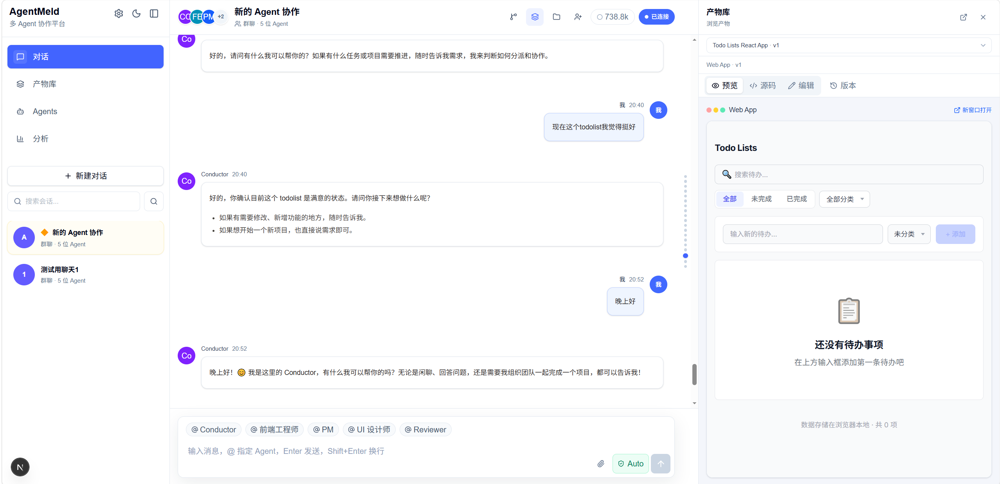

# AgentMeld

<p align="center">
  
  
  
  
  
  
  <a href="../LICENSE"></a>
</p>

<p align="center">
  <a href="../README.md">English</a> · <strong>简体中文</strong>
</p>

AgentMeld 是一个本地优先的多 Agent 协作工作空间。它把复杂的 AI 辅助任务组织成可观察的团队群聊：Conductor 负责理解用户意图、澄清需求、拆分任务、调度不同角色的 Agent，并把工具执行、证据、文件工作区和生成产物统一放在同一个会话里。

当前版本重点是 **证据驱动的上下文工程** 和 **Agent Runtime 可观测性**。AgentMeld 不只是让多个 Agent 聊天，而是记录每个 Agent 实际拿到了什么上下文、上游产物是否可用、工具是否真正执行、产物是否通过验证，以及任务为什么成功、失败、重试或阻塞。



## 适用场景

AgentMeld 适合本地、可检查、可追踪的多 Agent 工作流，例如：

- 从一句自然语言需求出发，完成 PRD、UI 风格、前端实现、审查和本地预览。
- 在一个会话中协调 PM、UI 设计师、前端工程师、Reviewer 和自定义 Agent。
- 让 Agent 安全地读写文件、执行验证命令、生成产物、请求用户审批、部署本地预览。
- 排查为什么下游 Agent 没看到 PRD、没读取风格指南、构建失败、部署失败或产物无法验证。
- 在本地探索上下文工程策略，而不是把工作区交给外部 SaaS。

## 核心能力

### 多 Agent 协作空间

- 支持单 Agent 与多 Agent 群聊式会话。
- Conductor 负责需求澄清、任务计划、DAG 调度、失败重试和结果聚合。
- 每个 Agent 可以独立配置模型、API Key、Base URL、系统提示词、能力标签和工具权限。
- 多步骤任务执行前支持计划审查。

### 证据驱动 Runtime

- 每个子任务可以声明 expected outputs、required inputs、acceptance criteria 和 required evidence。
- Output Binding 把上游产物和下游任务连接起来。
- Verification Engine 校验产物存在、产物类型、命令证据、部署证据和结构化验收结果。
- 任务失败后可以携带失败上下文重试，而不是重放整段聊天历史。

### 上下文工程

- Task Context Compiler 会基于 DAG 依赖、已验证上游输出、当前事实、workspace 状态、失败原因和相关历史生成任务专属上下文。
- Fact Registry 维护会话级结构化事实，支持事实校验、替换和过期。
- 每次 task attempt 的上下文快照都会持久化，方便后续审查。
- Context Trace 可以查看 included / omitted context、上游输入、证据、verdict、output binding、warnings 和后端诊断结论。

### 工具与安全

- 内置工具覆盖文件浏览与目录创建、文件读取、完整写入、局部 patch、命令验证、产物生成、部署预览、用户询问、附件读取、证据读取、事实更新、任务规划和任务汇报。
- 已有源码文件的局部修改优先使用 `fs_patch`，新建文件或明确完整覆盖时使用 `fs_write`。
- Shell 工具只允许验证命令和经过用户审批的依赖安装；禁止用 shell 重定向、PowerShell 写文件、`sed` 或破坏性清理命令修改源码。
- Workspace 路径会经过沙箱校验，限制越权访问。

### 产物与本地预览

- 支持文档、Web 应用、图片和演示文稿四类产物。
- Web 应用产物和工作区构建产物可以部署为本地静态预览。
- 产物库支持版本、预览、源码查看、编辑和部署卡片。

### 可观测与诊断

- 支持按 attempt、child run 和 conductor run 查询 Context Trace。
- 前端 Context Trace Drawer 可以诊断缺少上游输入、上游产物未读取、output binding 失败、verdict 失败和工具证据不足。
- 运行诊断看板展示上游读取密度、工具失败、耗时和产物可预览率。
- SSE 流式事件覆盖消息、工具调用、审批、任务进度、上下文摘要、证据、verdict、产物和 token 用量。

## 工作流示例

```text
用户："帮我做一个番茄时钟 App"

1. Conductor 分析需求和当前可用 Agent。
2. 如果需求不明确，Conductor 先调用 ask_user 询问用户。
3. 如果需求已经明确，Conductor 调用 plan_tasks 生成 DAG：
   - PM：输出 PRD
   - UI 设计师：输出风格指南
   - 前端工程师：实现并部署应用
   - Reviewer：审查最终产物
4. 用户审查并批准计划。
5. 不同 Agent 按依赖顺序执行。
6. 每次工具调用都会记录为结构化证据。
7. 上游产物经过验证后绑定到 outputKey。
8. 下游 Agent 只收到和当前任务相关的上下文。
9. Context Trace 可以解释每个 Agent 当时看到了什么。
10. 最终产物和本地预览显示在会话右侧。
```

## 架构概览

```text
src/
  app/          Next.js 页面与 API 路由
  components/   对话、Agent、产物、审批、Trace 与工作区 UI
  db/           SQLite 初始化、Schema、内置数据和持久化辅助代码
  server/       Agent Runtime、Conductor、工具、Adapter、验证、上下文、证据
  shared/       共享类型、ID、常量和显示辅助函数
  stores/       Zustand 状态与 SSE 事件 reducer
```

运行链路：

```text
Next.js UI
  -> API Route
  -> Conversation Service
  -> Agent Runner
  -> OpenAI-compatible Adapter
  -> ToolRegistry
  -> Evidence Ledger / Artifact Store / Workspace
  -> SSE Events 返回前端
```

## 技术栈

- Next.js 16、React 19、TypeScript
- Zustand 与 Immer
- SQLite、Drizzle ORM、`better-sqlite3`
- Pi 0.84.2 执行内核，模型使用已配置的 OpenAI-compatible 或 Anthropic 供应商
- Tailwind CSS
- Vitest、ESLint、TypeScript 检查

## 环境要求

- Node.js 22.19.0 或更高版本
- pnpm 10 或更高版本
- 至少一个模型服务 API Key，例如 DeepSeek

## 快速开始

```bash
git clone https://github.com/jackie-cqz/AgentMeld.git
cd AgentMeld
pnpm install
cp .env.example .env.local
pnpm dev
```

打开 [http://localhost:3000](http://localhost:3000)。

Windows PowerShell 使用：

```powershell
Copy-Item .env.example .env.local
```

应用启动后，也可以直接在 AgentMeld 设置面板中填写 API Key。

## 配置

常用环境变量（完整清单见 `.env.example`，其中也包含仅 benchmark 使用的变量）：

```env
AGENTMELD_DATA_DIR=.agentmeld-data
AGENTMELD_DB_PATH=.agentmeld-data/agentmeld.db
DEEPSEEK_API_KEY=your_api_key
DEEPSEEK_BASE_URL=https://api.deepseek.com
```

每个 Agent 也可以在界面中单独配置模型、API Key、Base URL 和工具权限。

## 常用命令

```bash
pnpm dev        # 启动开发服务
pnpm build      # 创建生产构建
pnpm start      # 启动生产服务
pnpm typecheck  # TypeScript 检查
pnpm lint       # ESLint 检查
pnpm test       # 运行 Vitest 测试
pnpm db:push    # 用 drizzle-kit 应用 src/db/schema.ts 这份类型化镜像。仅对全新空库安全：对应用已建好的库（src/db/bootstrap.ts）它会提议删除检索（FTS）表，切勿对真实数据运行，更不要加 --force。详见 docs/schema.md
pnpm db:seed    # 必要时创建本地数据库并打印各表行数（不会插入示例数据）。同时会触发启动恢复 —— 见命令列表下方的说明
pnpm e2e:fixture # 评估一次已完成的运行：pnpm e2e:fixture <runId> <fixturePath>
pnpm e2e:report  # 列出 benchmark fixture；或加 --run <runId> --fixture <path> 评估某次运行
pnpm quality:gates # 基于已保存的 benchmark 报告运行发布质量门禁，门禁失败时以非 0 退出；全新 clone 尚无 benchmark 数据，minimum-fixtures 门禁会失败
pnpm agent:bench        # benchmark 命令入口，必须带参数（见 pnpm agent:bench:all）；不带参数只打印用法并以 1 退出
pnpm agent:bench:all    # 列出全部 benchmark fixture 和用法示例（不执行运行）
pnpm agent:bench:smoke  # 运行标记为 smoke 的 benchmark 用例
pnpm agent:bench:full   # 运行完整 benchmark 套件
```

仓库中也保留了早期评估和 fixture 脚本。运行应用代码的脚本（`db:seed`、`e2e:*`、`quality:gates`、`agent:bench*`）会先读 `.env.local` 再读 `.env`（通过 `scripts/load-env.mjs`）。其中 `e2e:*` 与 `agent:bench --run/--compare` 通过 HTTP 访问已启动的应用，`agent:bench --case/--suite` 则在进程内驱动对话；它们都需要模型服务凭据。当前版本的核心定位仍是运行时可观测性，而不是完整 benchmark 平台。

`pnpm db:seed` 会调用 `ensureDatabase()`，从而触发启动恢复（`src/db/bootstrap.ts`）。该恢复会把所打开数据库中所有仍标记为 `running` 的 run 强制判为失败 —— 而它打开的正是应用所用的同一份数据库。所以在 dev server 旁边执行 `db:seed` **不会终止**该 server 正在执行的任务：没有任何跨进程中止，server 在任务结束时还会把 run 状态覆盖回去。但它会在此期间把这个 run 标记为失败、把它的 attempt 标记为 rejected，脚本也会明确打印出来（`[run-recovery] Marked 1 orphaned runs as interrupted.`）。请先停掉 server，或让 `db:seed` 指向另一份 `AGENTMELD_DATA_DIR`。其他脚本不受影响：`e2e:*` 与 `quality:gates` 根本不打开数据库，`agent:bench*` 则在调用 `ensureDatabase()` 之前就把 `AGENTMELD_DATA_DIR` 切到自己的 benchmark 目录。

## 本地数据

AgentMeld 默认将本地数据库、工作区、预览、部署和运行时生成文件保存在：

```text
.agentmeld-data/
```

首次启动时，AgentMeld 会自动创建 `.agentmeld-data/agentmeld.db`，初始化所需数据表，并写入内置 Agent。普通用户不需要提前创建数据库，也不需要在启动前运行 `pnpm db:push`。

该目录已被 Git 忽略。请勿提交 `.env.local`、API Key、本地数据库、生成的 workspace 或部署产物。

## 模型服务说明

所有生产 Agent（包括 Conductor）统一通过项目锁定的 Pi 执行。供应商和模型仍在 AgentMeld 设置中维护，Agent 编辑页选择对应模型；Pi 安装检测只代表版本可用，不代表供应商认证已通过。

自研 Agent Loop、生产 Adapter 注册表及 Claude Code/Codex 占位执行器已退役。原 Custom/Mock 配置迁移到 Pi，保留身份、聊天历史和渠道绑定；其他旧执行器必须在编辑界面显式迁移，不会静默回退。

详见 [Pi 执行架构与恢复说明](pi-runtime.md)。原生文件能力复用已有 `fs_*` 权限，计划、询问、产物和部署通过平台业务工具桥接。此私有扩展桥不是外部 MCP 服务。每次调用创建独立 Pi 会话，平台负责跨任务上下文；旧历史不转换成 Pi 原生会话，崩溃的命令不会自动恢复。命令仍在宿主机执行，不是 OS 沙箱。同一数据目录只运行一个控制服务；无法确认退出的执行会保留工作区租约。当前不支持任意全局 Pi 版本、用户扩展、其他 Harness 或 standalone 打包。

## 已知限制

- AgentMeld 面向本地单用户工作流，暂不提供多用户登录和权限隔离。
- 当前部署能力生成的是本地静态预览，不负责发布到托管云平台。
- 工具调用稳定性仍会受到模型行为影响，尤其是大段 JSON 工具参数。
- 评估和 fixture 脚本尚不是完整自动化 benchmark 平台。
- 项目仍处于活跃开发阶段，内部 schema 和 API 后续可能调整。

## 后续方向

- Stable Prefix / Dynamic Suffix prompt 布局，提升 prefix cache 友好性。
- Task State Context，让每个 Agent 先看到当前任务结构化状态。
- Evidence Card，把长工具结果整理成短证据卡片后再进入上下文。
- Playbook / Skill Registry，在事实记忆之外增加经验记忆。
- Multi-intent Query Planner，在任务拆分前先解析用户多意图。
- 更强的运行诊断、Trace 跳转和失败恢复体验。
- 外部 MCP 工具接入，同时复用现有 ToolRegistry 的权限、审批、证据和 SSE 机制。

## 当前状态

AgentMeld 仍处于活跃开发阶段。当前版本可以视为 Context Observability 与 Evidence-Aware Runtime Diagnostics 版本。

## 开源许可证

AgentMeld 使用 [MIT License](../LICENSE) 开源。
