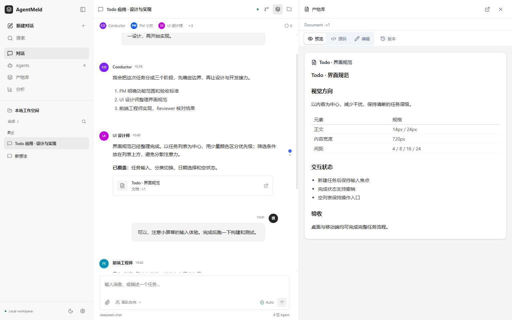
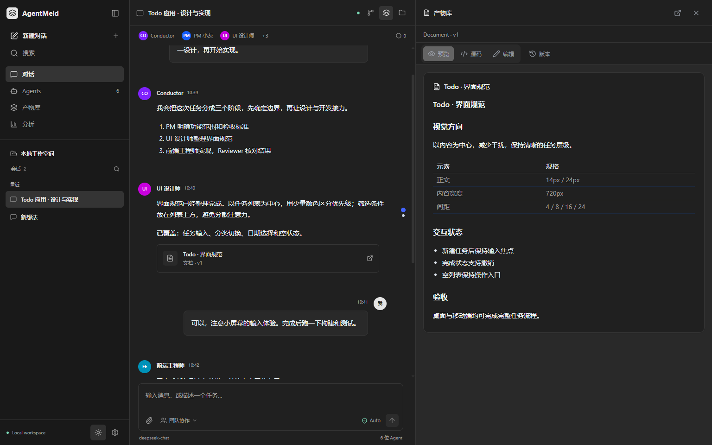
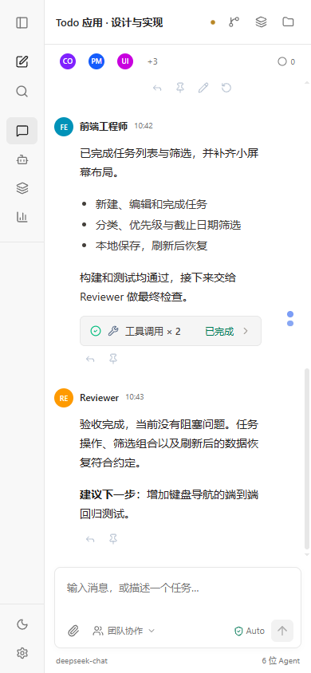

# Main Workspace Redesign

## Scope

This iteration changes the primary workspace, not just settings and dialogs.
It borrows layout principles from coding workspaces and the local DeepSeek
Harness frontend: compact navigation, quiet surfaces, a continuous transcript,
and a composer with separate text and action rows. No reference source code or
assets were copied.

- A compact conversation sidebar replaces large colored navigation buttons.
- Conversation filtering, pinning, renaming, archiving, deletion and global
  search remain available. Row menus work without right-clicking.
- Agents, the artifact library and analytics use the main content area rather
  than the narrow sidebar. The conversation stays mounted while these views
  are open, preserving drafts and reading position.
- Agent replies are unframed and share the same content column. User messages
  retain content-sized bubbles. Role colors and Agent profile access remain.
- The composer separates the draft from attachments, recipients, approval mode
  and sending. Recipient selection supports multiple Agents. Model information
  comes from the actual selected/default Agent, not a simulated model picker.
- Tools retain Chinese names and grouped expansion, with restrained surfaces
  and colored status icons. Artifact references use real artifact metadata when
  reference metadata is missing.
- The right workspace starts closed. Files, artifact references and the header
  actions open it on demand. The existing resize and unsaved-editor guards remain.
- Light/dark themes and small-screen navigation are supported. The message
  timeline retains a reserved lane to the right of user avatars.

Server, database, API and shared runtime code are unchanged relative to the
starting master commit `51019f6`. This is not a new Harness integration or a
change to Conductor scheduling, context compilation, permissions or SSE.

## Screenshots

These screenshots use synthetic UI fixtures, not a real model execution.







## Implementation

| Area | Files |
| --- | --- |
| Layout and secondary main views | `src/components/app-shell.tsx`, `workspace-view.tsx` |
| Navigation and conversation actions | `src/components/sidebar.tsx` |
| Transcript, header and scroll restoration | `src/components/chat-panel.tsx` |
| Composer and recipient routing | `src/components/message-input.tsx` |
| Tools and artifact references | `src/components/tool-card.tsx`, `message-parts.tsx` |
| Visual rules | `src/app/workspace.css`, `globals.css` |
| On-demand workspace default | `src/stores/app-store.ts` |

The native modal/popover primitives and existing API contracts are reused.
Next.js's floating development indicator is disabled because it overlaps the
bottom controls of the compact sidebar; runtime error reporting is not removed.

## Verification

Use an isolated data directory for browser tests. Never point the workflows suite
at a production/user data directory: it creates test Agents, conversations,
attachments and artifact versions. It does not call a real model.

```powershell
$env:AGENTMELD_DATA_DIR = Join-Path $PWD '.tmp-ui-data'
pnpm dev -- --port 3018 --hostname 127.0.0.1
```

Start a separate Chrome profile with remote debugging on port 9223, then run:

```powershell
node tests/ui/main-workspace.mjs
node tests/ui/regression.mjs
node tests/ui/workflows.mjs
node tests/ui/error-states.mjs
pnpm typecheck
pnpm lint
pnpm build
```

`UI_BASE_URL` and `UI_CDP_URL` override browser-test endpoints. Screenshot and JSON
reports are written under the ignored `.tmp-ui-artifacts/` directory.

Validated on 2026-10-15:

- Main workspace at 1536, 1280, 1024, 768 and 390px: conversation, split view,
  dark theme, empty state, full-width Agent management, draft/scroll retention,
  recipient IDs in the send payload, serialized approval changes, filtering,
  renaming, pinning and mobile sidebar dismissal.
- Existing regression suite: ten viewport/theme combinations plus fixed dialog
  footers, focus, unsaved changes, resize, timeline spacing, pending approvals,
  file tabs, context statistics and trace drawers.
- Real isolated API workflows: Agent create/edit, conversation/member save,
  attachment upload/select/delete and artifact version save. External Feishu
  operations and model connection checks are mocked.
- Settings error suite: load retry, duplicate-submit prevention, retained input,
  long error messages, short-window footer access and reverse focus traversal.
- TypeScript and production build passed. ESLint reported no errors; the changed
  frontend files lint cleanly. Existing repository warnings remain.

The full Vitest run reported 1,371 passed, 2 skipped and 3 failed tests. The
failures are in unchanged Feishu backend tests: two assertions concatenate `/`
into Windows filesystem paths, and one symlink fixture fails with Windows
`EPERM`. These failures were not suppressed or fixed in this frontend change.
The build also reports the existing backend SDK file-tracing warnings.
