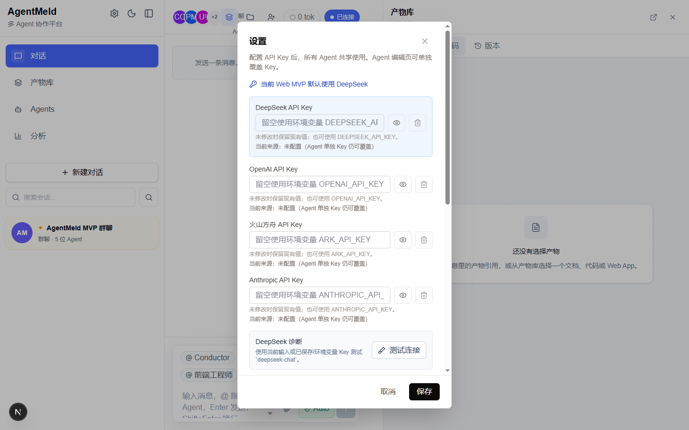
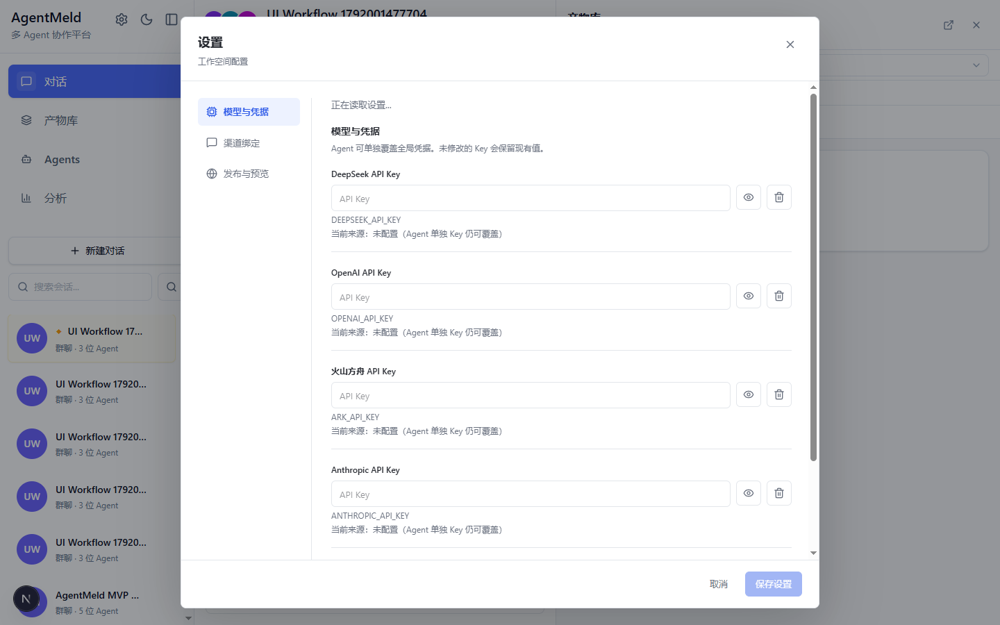
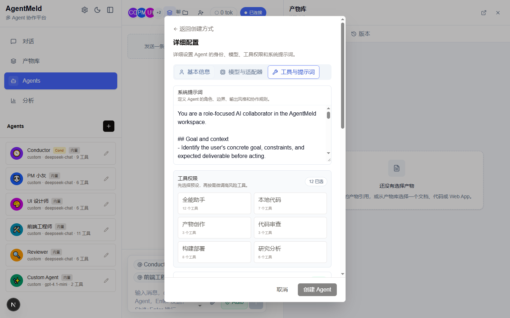
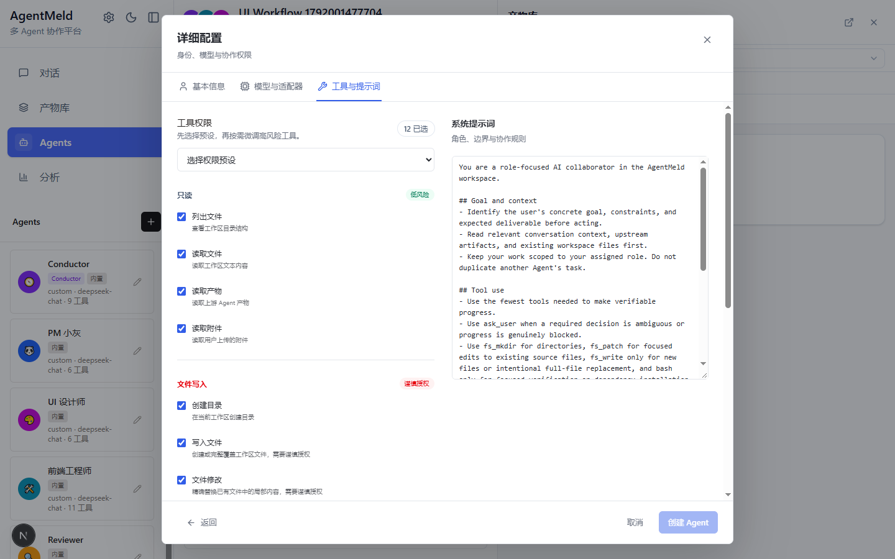
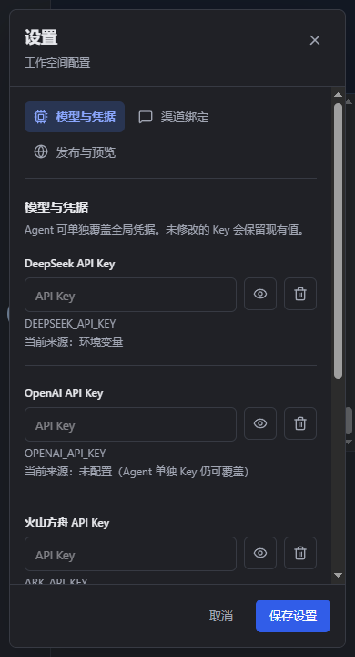
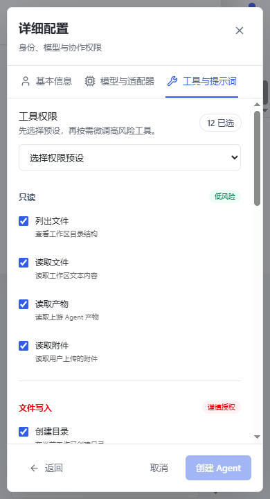
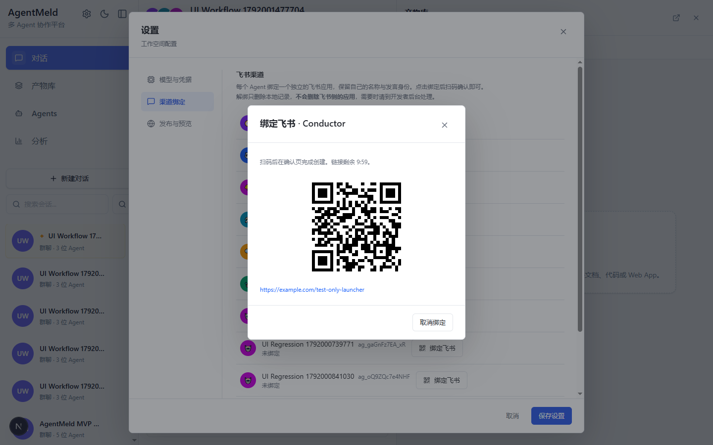
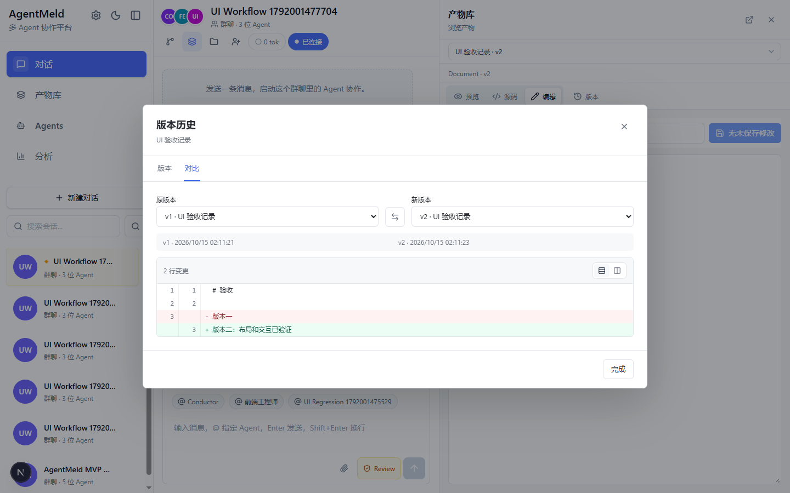

# Issue #31: Frontend Refactor Validation

## Scope and Baseline

The implementation starts from `1b08ffb` and is rebased on `0c2d97e` so that the Feishu connection, inbound and projection work in PRs #32-#35 is preserved. It changes frontend presentation and navigation, not Runtime, Conductor, tool execution, database schemas, or API contracts. The only server-side file changed is a test: Bash policy expectations now use native platform paths instead of Unix-only literals.

The visual direction is a compact work surface: neutral semantic colors, restrained blue actions, consistent 6-8px corners, a single scrolling modal body, and fixed header/navigation/footer regions. No marketing screen or new UI/state framework is introduced.

## Entry Point Inventory

| Entry | Surfaces | Verification |
| --- | --- | --- |
| Settings | Model credentials, connection test, publishing, Feishu bindings | Load retry, error/input preservation, double-click protection, fixed footer |
| Agents and conversation avatars | Description, capabilities, edit entry, creation choice, quick/detailed configuration | Native modal/popover, role colors preserved, persisted create/edit |
| Tool permissions | Preset selector, grouped checkboxes, prompt editor | Two columns on desktop, stacked on small screens, existing permissions retained |
| Conversation controls | New conversation, member management, attachments, global search | Creation/member persistence, upload/select/delete, keyboard search |
| Workspace files | Resizable tree, central file tab, return to chat | File content renders; returning preserves bottom position |
| Artifact workspace | Preview/source/edit, versions, comparison, deletion | Persisted new version, real comparison, unsaved draft guard |
| Pending actions | Questions, dispatch plans, command/file approvals | Requests remain structured; long commands wrap; resolution events update UI |
| Diagnostics | Context statistics, context trace, evidence drawer | Shared popover/drawer surfaces with accessible close and tab controls |

## Reproducible Browser Checks

These scripts attach to Chrome through CDP using Playwright. Use an isolated data directory; `workflows.mjs` creates test Agents, conversations, attachments and artifacts. Do not point it at your production data directory.

Start AgentMeld in one PowerShell terminal:

```powershell
$env:AGENTMELD_DATA_DIR = Join-Path $PWD '.tmp-ui-data'
node node_modules/next/dist/bin/next dev --port 3018 --hostname 127.0.0.1
```

Start an isolated headless Chrome profile and run checks in another terminal:

```powershell
$profile = Join-Path $PWD '.tmp-ui-cdp-profile'
Start-Process 'C:\Program Files\Google\Chrome\Application\chrome.exe' -WindowStyle Hidden -ArgumentList @('--headless=new', '--remote-debugging-port=9223', "--user-data-dir=$profile", '--no-first-run', 'about:blank')
node tests/ui/capture.mjs after
node tests/ui/regression.mjs
node tests/ui/workflows.mjs
node tests/ui/error-states.mjs
```

`UI_BASE_URL` and `UI_CDP_URL` override the default endpoints for the three regression scripts. The capture helper uses the endpoints above. Screenshots and JSON reports are written under `.tmp-ui-artifacts/`, which is ignored by Git and ESLint.

### Coverage

- Widths: 1440, 1280, 1024, 768 and 390px; both light and dark; right pane open and closed.
- Short windows: 1280x600 for modal workflows and 1280x420 for long save failures.
- Modal bounds, horizontal overflow, footer reachability, Tab/Shift+Tab boundaries, Esc and nested-dialog focus restoration.
- Unsaved settings, Agent configuration and artifact drafts; continued editing preserves input.
- Sidebar expansion on small screens, keyboard pane resizing, message rail/avatar separation, workspace file rendering and chat return position.
- Agent creation/edit and tool preset persistence; conversation creation and member persistence; attachment upload/selection/deletion; artifact version persistence/comparison.
- Settings load retry and failed save retry; a double-click does not send duplicate save requests.
- Feishu bound/unbound/awaiting-scan/cancel transitions; the new connection status remains distinct from binding status.
- Structured question answers, dispatch approval and command rejection; corresponding stream events remove resolved pending actions.
- Context statistics popover and context trace drawer, including keyboard close and view tabs.

### Boundaries

CRUD and artifact workflows use the real local API/SQLite layer. External model connection tests and Feishu application registration are mocked, so the checks do not call a paid model or create/delete a real Feishu application. Pending Runtime actions and their resolution events are browser fixtures; this is frontend contract verification, not a claim that a real Coding Agent run was executed. Existing backend tests cover approval and channel state safety.

Browser verification uses current Chromium. Native dialog/popover support is required; Firefox/Safari and physical mobile devices have not been certified by these checks. Mobile PWA expansion remains outside this issue.

## Verification Results

- `pnpm typecheck`: passed.
- `pnpm lint`: passed, with 52 existing unused-variable warnings.
- `pnpm test`: 109 files passed; 1221 tests passed; 2 existing tests skipped on the final rebased baseline.
- `pnpm build`: passed. An existing Turbopack file-tracing warning remains in the SDK/backend import graph.
- All three CDP regression scripts passed without runtime page errors.

For unit tests, remove inherited provider credentials from the test process. Missing-key tests intentionally assume no configured provider; leaving a real key in the shell changes their behavior and can cause unintended network calls. This does not require changing `.env` or your application settings.

## Visual Evidence

Screenshots were manually inspected, not merely generated. Checks exposed and led to fixes for a missing settings modal in the compact sidebar, focus leaking on Tab, nested-dialog focus restoration, and the cramped mobile composer. Data shown here comes from an isolated test workspace.

### Settings

Before:



After:



### Permissions and Prompt

Before:



After:



### Small Screens and Nested Surfaces








